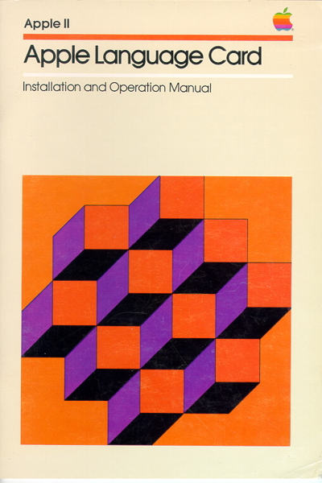
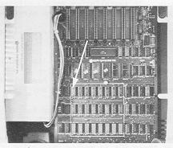
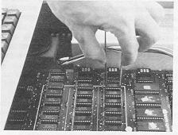
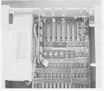
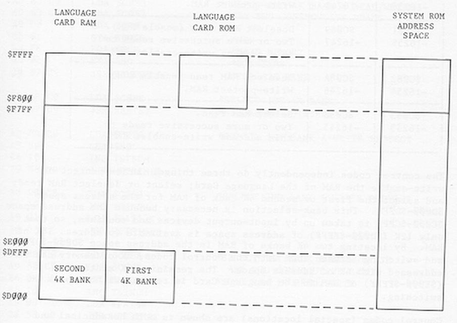
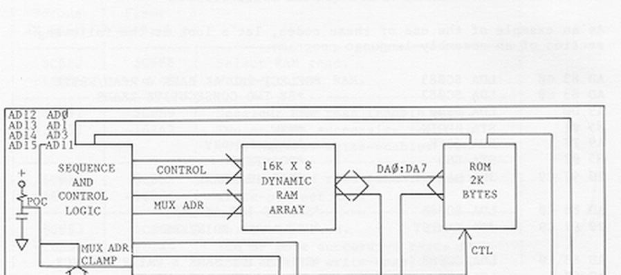

# Apple Language Card — Installation and Operation Manual



> **Archival transcription.** This is a Markdown adaptation of Apple's *Apple Language Card: Installation and Operation Manual*, reproduced from a 34-page scanned booklet. The RetroAppleJS filename `MS16K_user_manual.md` is used for the emulator's 16K Language Card documentation; the original manual describes the **Apple Language Card**, not the differently branded Microsoft RAM Card. The historical installation instructions apply to original hardware, not to the browser emulator.
>
> **Document note:** Tables have been recreated in Markdown, machine examples are monospaced, and original figures are kept as separately linked images under `docs/assets/`. The scanned source has some faint characters; check physical hardware, addresses and exact program listings against an original if using them for restoration or assembly.

## Contents

| Section | Original printed page |
|:---|---:|
| [Radio and television interference](#radio-and-television-interference) | iv |
| [Chapter 1 — System requirements](#chapter-1--system-requirements) | 1 |
| [Chapter 2 — Installation](#chapter-2--installation) | 3 |
| [Chapter 3 — Using the Language Card](#chapter-3--using-the-language-card) | 7 |
| [Chapter 4 — The Autostart ROM](#chapter-4--the-autostart-rom) | 11 |
| [Appendix A — Autostart ROM BASIC features](#appendix-a--summary-of-autostart-rom-basic-features) | 21 |
| [Appendix B — Autostart ROM technical information](#appendix-b--autostart-rom-technical-information) | 22 |
| [Appendix C — Memory map](#appendix-c--memory-map-of-language-card) | 25 |
| [Appendix D — Language Card control codes](#appendix-d--language-card-control-codes) | 26 |
| [Appendix E — Functional block diagram](#appendix-e--functional-block-diagram-of-language-card) | 28 |

**Warning (from title page):** Read the manual before installing the Language Card. Incorrect installation could permanently damage the Language Card and the Apple.

## Radio and television interference

The equipment described in this manual generates and uses radio frequency energy. If it is not installed and used properly, that is in strict accordance with our instructions, it may cause interference to radio and television reception.

This equipment has been tested and complies with the limits for a Class B computing device in accordance with the specifications in Subpart J of Part 15 of FCC rules. These rules are designed to provide reasonable protection against such interference in a residential installation. However, there is no guarantee that the interference will not occur in a particular installation.

You can determine whether your computer is causing interference by turning it off. If the interference stops, it was probably caused by the computer. If your computer does cause interference to radio or television reception, you can try to correct the interference by using one or more of the following measures:

- Turn the TV or radio antenna until the interference stops. - Move the computer to one side or the other of the TV or radio.

- Move the computer farther away from the TV or radio.

- Plug the computer into an outlet that is on a different circuit from the TV or radio. (That is, make certain the computer and the TV or radio are on circuits controlled by different circuit breakers or fuses.)

If necessary, you should consult your dealer or an experienced radio/television technician for additional suggestions. You may find the following booklet prepared by the Federal Communications Commission helpful:

"How to Identify and Resolve Radio-TV Interference Problems" This booklet is available from the U.S. Government Printing Office, Washington, DC 20402, Stock number 004-000-00345-4.

iv APPLE LANGUAGE CARD

## Chapter 1 — System requirements

The Language Card is intended for an **Apple II or Apple II Plus equipped with 48 KiB of RAM** on the main printed-circuit board. If the computer has less memory, the additional RAM must be installed before the card is fitted. The original manual recommends Apple's 16K Memory Expansion Modules and refers users to their Apple dealer for parts and instructions.

Although the Language Card itself does not require a floppy drive, many programs and languages that take advantage of its extra 16 KiB also require at least one **Disk II** drive and disk-controller card. The system can use as many as three disk-controller cards, each supporting one or two drives.

For Disk II users, Apple recommends **16-sector disk format**. The Language Card is compatible with DOS 3.2 and 3.2.1, which use the older 13-sector format, but programs distributed for 16-sector DOS will not run with that format. The card is **not compatible with versions of DOS earlier than 3.2**. DOS 3.3 provides the files and facilities needed to convert the system to 16-sector operation.

> **Warning from the original manual:** Apple Computer cannot guarantee compatibility with third-party RAM integrated circuits. Their use was not recommended and could void the original warranty.

## Chapter 2 — Installation

The following steps describe the historical hardware procedure. **Do not install or remove components with the Apple powered on.** Incorrect installation can damage both the Language Card and the computer. If the process is unfamiliar, ask a qualified technician to perform it.

### Open the computer and locate the RAM socket

1. Switch the Apple **OFF** and verify that its power light is out.
2. Remove the cover by lifting its rear edge until the two corner fasteners disengage, then slide the cover backward, away from the keyboard.
3. With the keyboard toward you, identify the white outlined RAM area immediately behind the keyboard. It contains **24 RAM ICs**. The original manual mentions markings such as `MK4116`, `MCM4116`, `uPD416`, and `HM4716`. The board is marked `RAM`; the notched ends of these ICs point toward the keyboard.
4. Locate the **left-rear RAM IC (socket F3)** nearest the expansion slots. This is the IC that the Language Card's ribbon-cable plug will replace. **Do not remove it yet.**



*Original manual, printed p. 4: Apple II with its cover removed, showing the expansion slots and memory area.*

Across the rear of the motherboard are eight long edge connectors (expansion slots), numbered on the board. The Language Card fits in **slot 0**, the leftmost slot when viewing the computer from the keyboard. The Apple Language Card and the Applesoft II Firmware Card cannot be installed together. With the Language Card, the full Applesoft BASIC can instead be loaded from the DOS System Master diskette.

### Remove the existing RAM IC

1. Touch the grounded metal power-supply cover to discharge static electricity. The original manual identifies it as the large silver- or gold-colored enclosure at the left side of the computer.
2. If another card occupies slot 0, gently rock it up and down while lifting it out.
3. Locate the RAM IC in socket F3 and fit the supplied **IC puller** around its two narrow ends. The U-shaped tool has a prong on each arm, which should fit into the small gaps between the IC and socket.
4. Grip the IC evenly. Wiggle the puller slightly toward the slots and keyboard while lifting **very gently**. Keep the IC level; both ends and both sides should come free together. If a side sticks, release tension and adjust the puller rather than forcing it.
5. Store the removed IC safely, ideally in the Language Card packaging. If the IC does not come out easily, consult your dealer instead of risking damage.



*Original manual, printed p. 5: removing the RAM IC from the motherboard.*

### Fit the Language Card and ribbon cable

1. Place the Language Card in front of you with its lettering upright. The **ribbon cable** exits near the lower left and has one differently colored edge. Its plug has three plastic alignment prongs: two round and one rectangular. The card's edge-connector tongue is at the bottom right.
2. Hold the card in your right hand with its ICs facing downward and the cable end toward you. Set it gently on the motherboard and align the ribbon-cable plug over the now-empty left-rear RAM socket.
3. Ensure that the differently colored cable edge is **toward the keyboard**, and that every plug pin aligns with a socket hole. Apply light, even pressure; the plug should seat without force.
4. If the motherboard socket lacks the two round alignment holes, **do not force the plug**. The original manual advises having a dealer remove the alignment prongs or fit an appropriate second RAM socket, piggyback-style.
5. When seated, the cable should emerge from the right side of the plug with its differently colored edge toward you. Insert the card's edge connector in **slot 0**, pressing gently and rocking slightly until seated.
6. Check the complete installation: the card is firmly in the leftmost slot; the cable bends down toward the **F3 socket**; the plug is centered and fully inserted; and the marked cable edge faces the correct direction.



*Original manual, printed p. 6: the card in slot 0 and its ribbon cable connected to the RAM socket.*

Once satisfied, replace the computer's cover before continuing.

## Chapter 3 — Using the Language Card

Apple recommends **DOS 3.3 or later** to make full use of the Language Card. DOS 3.3 uses the 16-sector disk format, which stores more information than the earlier 13-sector format. It also loads the BASIC interpreter that is not built into the computer's motherboard ROM. You can still boot earlier 13-sector disks by following the procedure below.

DOS 3.2 and 3.2.1 can use the additional RAM, but they do not provide the 16-sector disk support required by many Language Card programs.

For the instructions in this chapter, the main Disk II drive is presumed to be **drive 1 connected to the controller in slot 6**. Unless otherwise indicated, disk references mean drive 1, slot 6. Additional drives and controller cards should be installed as described in the DOS manual.

The original **Apple II** normally has **Integer BASIC** in motherboard ROM, whereas the **Apple II Plus** has **Applesoft BASIC** in ROM. With no disk drives or accessory cards taking control, the computer's ROM BASIC appears at startup. Its prompt identifies the interpreter:

| BASIC interpreter | Screen prompt |
|:---|:---:|
| Integer BASIC | `>` |
| Applesoft BASIC | `]` |

### Using the extra memory

Some applications detect the Language Card automatically and use the extra memory. Ordinary programs that are unaware of it **do not automatically gain 16 KiB of usable address space**.

Programmers wishing to use it directly should study the memory map and bank-switching control codes in [Appendix C](#appendix-c--memory-map-of-language-card) and [Appendix D](#appendix-d--language-card-control-codes). Special memory-mapping techniques are required, but they are straightforward once the ROM/RAM overlays and bank-selection rules are understood.

### Using DOS 3.3 and BASIC

1. Insert the **DOS 3.3 System Master** diskette into drive 1.
2. Power on the Apple. The System Master boots DOS and loads the BASIC interpreter **not** resident in the motherboard ROM into Language Card memory.
3. On an original Apple II, **Applesoft BASIC** is loaded into the Language Card. On an Apple II Plus, **Integer BASIC** is loaded. A startup message identifies the BASIC being loaded.
4. DOS commands now work in either interpreter. Switch between BASICs with `INT` and `FP`, as described in the DOS manual. Observe the prompt (`>` for Integer BASIC, `]` for Applesoft).

You can reboot DOS without cycling the power: insert the System Master diskette and use `PR#6` or `IN#6`, then press `RETURN`.

### Using 13-sector diskettes

The **BASICS** diskette supplied with the DOS System Master can boot 13-sector DOS/BASIC diskettes on a 16-sector system. Older DOS versions (before 3.3) use 13 sectors per track.

1. Insert the `BASICS` diskette in drive 1 and power on the Apple.
2. After a few seconds the screen displays:

   ```text
   INSERT YOUR 13 SECTOR DISKETTE
   AND PRESS RETURN
   ```

3. Insert the 13-sector DOS/BASIC diskette to boot and press `RETURN`.

When booting another 13-sector disk using a reset or a command such as `PR#6` or `IN#6`, ensure that **BASICS is in the drive at the appropriate point in the boot procedure**. The source manual also mentions a monitor boot command and `CTRL-P` as possible ways to re-enter the boot path.

Once DOS has loaded, use `INT` and `FP` to switch between Integer BASIC and Applesoft BASIC normally. To convert your own 13-sector **data** diskettes to 16-sector format, consult the `MUFFIN` program described in the DOS manual. Most programs convert normally, but programs which depend on specific disk-sector positions may no longer boot after conversion. The procedure does not alter the original 13-sector diskette; retain it as a fallback.

### Using other languages

For Pascal, FORTRAN, or another language requiring the Language Card, obtain the corresponding software package and follow that package's startup instructions. **SAVE your current work before changing languages**: the program in memory may be erased by the changeover.

## Chapter 4 — The Autostart ROM

In addition to the extra 16 KiB of write-protectable RAM, the Apple Language Card carries an **Autostart ROM**. This ROM provides startup, disk-boot, RESET, BASIC-editing, and display-control features. It replaces the functionality of the older Monitor ROM that may be installed in the motherboard's `ROM-F8` socket.

If your computer already contains the Autostart ROM, the behavior described in this chapter will be familiar. Otherwise, the Language Card adds these features.

### The Autostart features

The Autostart ROM allows the Apple to behave as a **turnkey system**: a correctly prepared startup program can be launched automatically when power is turned on.

With the Language Card installed, startup displays `APPLE ][`, then attempts to boot the diskette in **drive 1, slot 6**. The boot disk may be the DOS 3.3 System Master or the startup diskette of a language that uses the card. When present, the diskette's greeting or `HELLO` program runs. If the card replaces an Applesoft II Firmware Card, Applesoft can instead be loaded from System Master.

If startup does not proceed, the original manual describes four common cases:

1. **No drive connected to drive 1, slot 6:** the computer waits until `RESET` is pressed.
2. **Drive connected but no diskette or the drive door is open:** the drive spins until interrupted with `RESET`.
3. **Unbootable diskette:** the drive may continue attempting to boot, even after RESET. Repeated rapid presses of `RESET`, or a complete power-off, stop the attempt.
4. **No suitable interface or a failed boot interrupted by RESET:** the Apple enters whichever BASIC is installed on its motherboard, **without DOS**.

### The RESET key

Switching power off and back on normally restarts the system and **loses the current program in RAM**. Pressing `RESET` while in BASIC instead interrupts execution and returns to the current BASIC prompt without intentionally discarding the program or DOS.

In BASIC, `RESET` is similar to `CTRL-C`, but the two are not identical. RESET restores the state used when the program originally began; `CTRL-C` interrupts without fully restoring starting values. A program run again after `CTRL-C` may therefore behave differently.

Assembly-language programmers may want RESET to enter monitor mode. Appendix B describes the Autostart ROM routine `SETPWRC` and associated reset-vector techniques.

### The BASIC-editing features

The Autostart ROM makes it possible to move the screen cursor without typing or replacing the text through which it moves. **Press `ESC` to enter edit mode**, then use this arrangement of four keys:

```text
             I   ↑
       J ←           → K
             M   ↓
```

| In edit mode | Action | Remains in edit mode? |
|:---:|:---|:---:|
| `I` | Move cursor up | Yes |
| `J` | Move cursor left | Yes |
| `K` | Move cursor right | Yes |
| `M` | Move cursor down | Yes |
| `A` | Move one character right | No |
| `B` | Move one character left | No |
| `C` | Move one line down | No |
| `D` | Move one line up | No |
| `E` | Clear from cursor to end of line | No |
| `F` | Clear from cursor to end of screen | No |
| `@` | Clear entire screen and home cursor | No |
| `SPACE` | Leave edit mode | No |

Holding a cursor-motion key and then pressing and holding **`REPT`** repeats that movement quickly. The cursor stops at the top boundary; at the bottom the display scrolls upward. At the left and right edges it wraps to the neighboring line.

The `ESC`-then-`A/B/C/D` movements work like familiar Old Monitor ROM commands: they move once and automatically return to normal mode. Most other keys also exit edit mode. To resume ordinary typing, leave edit mode, normally with the space bar.

**Clearing text:** Press `ESC`, move to the first character to clear and use the required command. For individual characters, leave edit mode and press the space bar for each character. To clear to the end of a line use `E`; to clear to the end of the screen use `F`; to clear the screen and home the cursor use `@`. Press `RETURN` to obtain the BASIC prompt after clearing the screen.

**Display versus memory:** The edits above change the *screen*, not necessarily the characters stored in a BASIC statement. To change the current line of input, use the Apple keyboard's two arrow keys:

| Key | Action while entering a BASIC line |
|:---|:---|
| **Left-arrow** (Delete) | Moves one position left and removes the previously typed character from the input line |
| **Right-arrow** (Retype) | Moves right and copies the character under the cursor into the current input line |

Retype followed by `RETURN` is equivalent to typing the same line anew. To **fast-retype**, hold the right-arrow key first, then hold `REPT`. Press the keys in this order: REPT repeats the *last key pressed before REPT*, so if the last key was the space bar, pressing REPT first can accidentally insert repeated spaces rather than retype characters.

#### Replacing, inserting, and deleting within BASIC statements

The manual uses an Applesoft example to show the difference between the *displayed line* and the *current input line*.

Start with:

```basic
10 PRINT "JABBERWOCK"
```

**Replace `JABBER` with `JIBBER`:**

1. `LIST` the program.
2. Press `ESC` and move onto the start of the line with the cursor keys.
3. Exit edit mode, then Retype up through the `J`.
4. Type `I` in place of the first `A`, fast-retype the remainder, and press `RETURN`.
5. `LIST` again to verify:

```basic
10 PRINT "JIBBERWOCK"
```

**Insert `JABBER` after `JIBBER`:**

1. `LIST`, then fast-retype the beginning of the statement through `JIBBER`.
2. Press `ESC`, move back to the `J` with cursor movement keys, and exit edit mode.
3. Type `JABBER` over the visible characters without erasing what was already entered in the input line.
4. Fast-retype the remaining letters and press `RETURN`; `LIST` shows:

```basic
10 PRINT "JIBBERJABBERWOCK"
```

**Delete the second `JABBER`:**

1. `LIST` and Retype everything through `JIBBER`.
2. Enter edit mode and **move the cursor across** `JABBER` without retyping it into the input line.
3. Exit edit mode, fast-retype the remaining `WOCK`, and press `RETURN`. `LIST` displays:

```basic
10 PRINT "JIBBERWOCK"
```

The manual encourages experimenting with these commands and listing the result after each change to see which characters actually entered BASIC memory.

#### Fast-retyping long statements

Long program statements may wrap onto the following screen line. The normal BASIC `LIST` formatting can insert spaces for indentation; if these are retyped into the input buffer they may alter a statement. The manual suggests this workaround:

1. Clear the screen with `ESC` then `@`.
2. Type:

   ```basic
   POKE 33,33
   ```

3. Press `RETURN`, then `LIST` the program. The text window is 33 characters wide, so lines wrap without indentation.
4. When finished editing, restore the usual text window with:

   ```basic
   TEXT
   ```

> **Warning from the manual:** Do not POKE a value **greater than 40** into location 33; this can overwrite Applesoft memory and the program.

### The stop-list feature

The Autostart ROM offers a way to **pause and resume listing text**, using `CTRL-S`. Hold the `CTRL` key and press `S` while the Apple displays a listing. The stop takes effect at a screen-line return. Press `CTRL-S` again to resume; another key (except the special keys described below) can also resume output.

To try it with a program of twenty or more lines, load or type the program, enter `LIST` but hold back `RETURN`, then press and hold `CTRL` and press `RETURN`. Press `S` while holding `CTRL` to stop the listing. Press `CTRL-S` again to resume. `RESET` terminates the listing.

The same mechanism can suspend a BASIC program which prints complete lines:

```basic
10 I = I + 1
20 PRINT I
30 GOTO 10
```

Run it and type `CTRL-S`; the Apple checks for the pause request when a line return is printed. `CTRL-S` again, or most other keys, continues. To stop the program and return to BASIC use `CTRL-C` or `RESET`.

The following variant **does not reliably pause**, because the semicolon after `PRINT` causes continuous text output without line returns:

```basic
10 I = I + 1
20 PRINT I;
30 GOTO 10
```

When there is no screen return, the display routine never performs the keyboard check needed to recognize `CTRL-S`. The original instructions exempt `SHIFT`, `RESET`, and `CTRL-C` from ordinary resume-key behavior.

## Appendices

### Appendix A — Summary of Autostart ROM BASIC features

| Command | Effect |
|:---|:---|
| Insert System Master diskette and turn on power | Boots DOS and loads the BASIC not in ROM into Language Card RAM |
| Press `RESET` | Stops and restarts, keeping the program |
| Press `ESC` | Enters edit mode |
| Press `SPACE` | Leaves edit mode |
| Press `I`, `J`, `K`, or `M` | Moves cursor in edit mode, staying in edit mode |
| Press `A`, `B`, `C`, or `D` | Moves cursor one space in edit mode and then leaves edit mode |
| Press left-arrow | Deletes last character typed |
| Press right-arrow | Retypes character the cursor is over |
| Press `ESC`, then `E` | Clears line from the cursor onward |
| Press `ESC`, then `F` | Clears screen from the cursor onward |
| Press `ESC`, then `@` | Clears entire screen |
| Type `CTRL-S` | Stops listing or screen display at the next RETURN |
| Type `CTRL-S` again | Resumes listing |

*Original table: printed p. 21.*

### Appendix B — Autostart ROM technical information

This appendix describes the differences between the Autostart ROM and the original Monitor ROM.

#### Subroutines added to the Autostart ROM

**APPLE II** — `$FB60`, `CALL -1184`

- **Purpose:** Clears the screen and POKEs the string `APPLE ][` into line 1 of the text buffer so the screen displays it on RESET.
- **Entry:** Set scrolling-window parameters to maximum limits using `TEXT`, or:

```basic
10 POKE 32,0
20 POKE 33,40
30 POKE 34,0
40 POKE 35,24
```

- **Exit:** `A=$C1; Y=0; X=entry`.
- **Status:** `N=0; Z=1; C=X; V=X`.

**SETPWRC** — `$FB6F`, `CALL -1169`

- **Purpose:** Lets RESET enter the monitor; sets location `$3F4` to the exclusive OR of `$3F3` and `$A5`.
- **Entry:** No special conditions, but location `$3F3` (POKE 1011) should contain the high byte of the RESET vector for the call to be meaningful.
- **Exit:** `A=EOR #$A5,$3F3; Y=entry; X=entry`.
- **Status:** `N=X; Z=X; C=entry; V=entry`.

The manual gives the following monitor example to make RESET enter the monitor:

```text
CALL -151
*3F2:69 FF 5A
```

It also describes setting a custom RESET vector to a routine at `$803` and calling `$FB6F` to enable RESET dispatch. Refer to the original ROM technical documentation when modifying live reset vectors.

#### Subroutines deleted

| Routine or group | Former ROM addresses |
|:---|:---|
| `STEP` (single-step simulator) | `$FA40–$FA85`; `$FAA5–$FAD6`; `$FAFD–$FB18` |
| `MULPM`, `DIVPM` | `$FB60–$FBC0` |

#### Subroutines changed

`IRQ/BREAK` moved from `$FA86` to `$FA40`.

**Page-3 memory usage** (default values are for non-disk systems after power-on reset):

| Location | Use | Default value |
|:---|:---|:---|
| `$3F0`, `$3F1` | Break vector | `$59`, `$FA` |
| `$3F2` | RESET vector, low byte | `$03`* |
| `$3F3` | RESET vector, high byte | `$E0`* |
| `$3F4` | Powered-up mask | `$45`* |

*Applies to non-disk systems after power-up RESET.*

#### Limitations of the Autostart ROM

1. Programs using the old Monitor's 16-bit integer multiply/divide routines will fail because these routines are absent.
2. Programs using any part of the old Monitor's single-step simulator code will fail for the same reason.

### Appendix C — Memory map of Language Card



*Original memory-map figure (printed p. 25).*

| CPU address range | Normal system-ROM view | Language Card RAM view |
|:---|:---|:---|
| `$F800–$FFFF` | Autostart ROM on the Language Card (2 KiB) | Final 2 KiB portion of the common upper RAM area |
| `$E000–$F7FF` | System ROM (motherboard) | 6 KiB portion of common upper RAM (8 KiB total through `$FFFF`) |
| `$D000–$DFFF` | System ROM (motherboard) | **One of two 4 KiB banks**, selected via language-card soft switches |

The figure shows the ROM and RAM views separately. The memory overlay is controlled via I/O soft switches and does not add a new CPU address range.

### Appendix D — Language Card control codes

The four primary switch operations are duplicated for the two 4 KiB banks at `$D000–$DFFF`. Address decoding ignores bit 2, so `$C084–$C087` alias `$C080–$C083`, and `$C08C–$C08F` alias `$C088–$C08B`.

| Second 4 KiB bank (hex) | Decimal | First 4 KiB bank (hex) | Decimal | RAM/ROM selection and write protection |
|:---|---:|:---|---:|:---|
| `$C080` | `-16256` | `$C088` | `-16248` | Select RAM for reads; **write-protect** RAM |
| `$C081` | `-16255` | `$C089` | `-16247` | Select ROM for reads; **two or more successive reads** write-enable RAM |
| `$C082` | `-16254` | `$C08A` | `-16246` | Select ROM for reads; **write-protect** RAM |
| `$C083` | `-16253` | `$C08B` | `-16245` | Select RAM for reads; **two or more successive reads** write-enable RAM |

The control codes independently perform three functions: select or deselect RAM for reads; write-protect or write-enable Language Card RAM; and select the first or second 4 KiB bank in `$D000–$DFFF`. The range `$C000–$CFFF` is reserved for input/output devices and routines, so only 12 KiB of CPU address space is available to address the card's 16 KiB. Two switchable 4 KiB banks share `$D000–$DFFF`; the other 8 KiB (`$E000–$FFFF`) requires no bank switching.

The table gives hexadecimal memory locations for assembly-language programs and their decimal equivalents for BASIC. In the address `$C08x`, **bit 3** selects the mapped 4 KiB bank: `0` selects the second bank (`$C080–$C083`) and `1` selects the first bank (`$C088–$C08B`) in the source manual's naming convention.

When RAM is deselected, Language Card ROM is selected at `$F800–$FFFF` and motherboard ROM at `$D000–$F7FF`. RAM can be write-enabled while ROM is selected for reads; in that mode, writes to the overlay affect RAM although reads return ROM bytes.

Power-on RESET initializes ROM-read mode, RAM-write mode, and the second 4 KiB bank.

#### Assembly-language control-code example

The original printed example makes **two consecutive reads** of `$C083` before testing RAM and then switches banks and read/write modes:

```asm
        LDA $C083      ; Select 2nd 4K bank and read/write
        LDA $C083      ; A second consecutive read enables writing
        LDA #$D0       ; Set up main-memory pointers
        STA BEGIN
        LDA #$FF
        STA END
        JSR RAMTST     ; Test 12K bank

        LDA $C08B      ; Select 1st 4K bank
        JSR RAMTST     ; Reuse pointers

        LDA $C088      ; 1st bank, RAM write-protected
        LDA #$80
        INC TSTNUM
        JSR WPTSINIT

        LDA $C080      ; 2nd bank, RAM write-protected
        INC TSTNUM
        LDA #PAT12K
        JSR WPTSINIT

        LDA $C08B      ; 1st bank, RAM read/write
        LDA $C08B      ; Two consecutive reads
        INC RWMODE     ; Flag RAM read/write
        INC TSTNUM
        LDA #PAT4K
        JSR WPTSINIT
```

`LDA` performs the soft-switch read; the resulting accumulator value is not used. That is why the example contains two consecutive `LDA` instructions. The routines and symbolic labels are excerpted from the historical listing and are not a standalone assembly program.

### Appendix E — Functional block diagram of Language Card



*Original functional block diagram (printed p. 28), showing the card's 16 KiB dynamic RAM array, the 2 KiB ROM, address decoding, control logic, and the 16-pin ribbon connection to the motherboard RAM socket.*

---

*Source: Apple Computer Inc., **Apple Language Card — Installation and Operation Manual**, original booklet. Figures excerpted from the user's supplied scan.*
