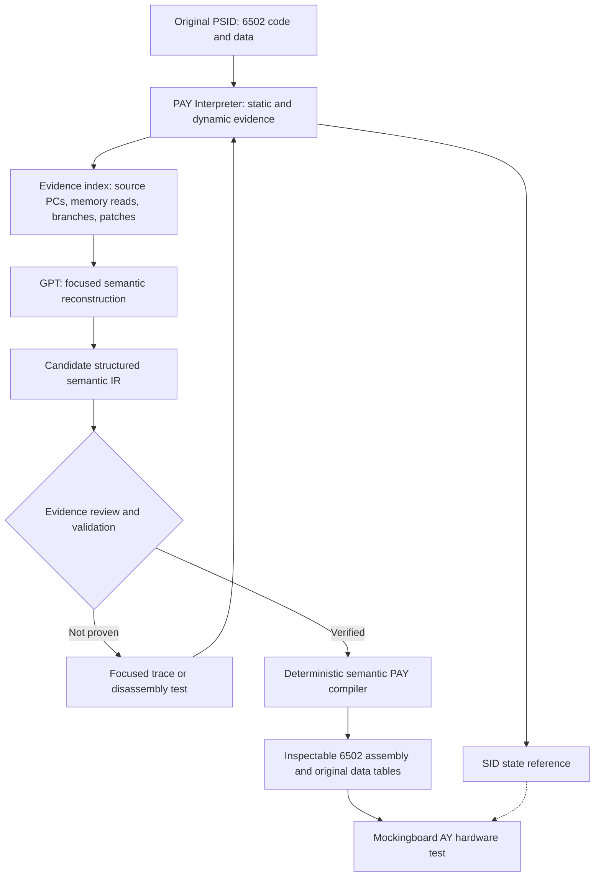

# PAY-00.8 — Source-semantic transpilation contract

**Status:** Phase 00.8A implemented: evidence extraction, GPT semantic candidate interface and structural validation. **Not yet** a semantic Bomberland native player or a fully decoded SID song. No OpenAI API calls were performed to generate this package; the four previous GPT disassembly analyses are incorporated as *unverified prior interpretations*.

## Architectural correction

The original PSID is executable program and musical data. The source program selects instruments, fetches command bytes, maintains counters, branches, computes frequency and filter parameters and writes to SID. The PAY compiler must discover and translate **those calculations and control decisions** into a new Apple II program; it must **not** compile an AY register history into a score.



**Forbidden shortcut:** `frameSnapshots -> AY register events -> 6502`. Prior PAY-00.7.3 remains a **reference renderer / fallback benchmark**, not the new compiler architecture.

## Inputs and evidence provenance

- Original 300-frame Bomberland v0.5.1 complete report, which contains the original PSID bytes and four previous GPT textual interpretation batches.
- Independently traced 3,000-frame (60-second) complete report for **the same PSID and subtune 1**. The extraction script checks byte-for-byte identity of the embedded original PSID.
- Long trace: **71,998 SID writes, 267,804 effective data reads, 9,278 self-modifying code writes; 0 dropped SID writes or data reads**. This is strong bounded execution evidence, **not a complete proof of the composition's control grammar**.
- Long-trace state-graph nodes and modified-code variants are capped. These caps must be disclosed, and conclusions requiring unretained records must remain unresolved.
- Existing original PSID load `$1000`, INIT `$1000`, PLAY `$1003`, three subtunes. Only subtune 1 was captured here.
- The interpreter's C64 model is not cycle accurate and does not emulate analog SID, CIA/VIC scheduling or all possible CPU paths. Frame indices mean bounded PLAY invocations.

`examples/PAY/Bomberland_PAY08_semantic_evidence.json` contains **166 evidence records**, with stable IDs such as `flow:$1305->$10C4` (only when observed), `read:$1385:X7`, `patch:$1306<-$12C7`, `sid:$13FF`, `code:$1305`, `static:$11C5`. Previous GPT reports carry `gpt:batch:N` IDs and are explicitly **not proof**. All IDs in the generated bundle come from actual observed records.

## Ten reconstruction targets

| ID | Source-level task | Candidate PAY semantics | Key unknowns |
|---|---|---|---|
| `player_entry` | INIT, PLAY, song/subtune selection | `PLAYER_INIT`, `PLAYER_TICK` | Untraced subtunes, external timing |
| `voice_tick` | Per-voice countdown and step advancement | `CHANNEL_WAIT`, `NEXT_STEP` | Reload and expiry conditions |
| `pointer_stream` | Indirect pattern/data pointer and token fetch | `FETCH_TOKEN`, `SET_PATTERN_PTR` | Exact escape/operand grammar |
| `command_dispatch` | Command classes and dynamic helper calls | `DECODE_COMMAND`, `EXEC_COMMAND` | Full dynamic target set |
| `runtime_patching` | Source code patches used as variables/dispatch | `SET_STATE`, `DISPATCH_STATE` | Separate stable state from program control |
| `pitch_slide` | Signed frequency arithmetic and target comparison | `PITCH_STEP`, `PORTAMENTO` | Speed, targets, stop conditions |
| `instrument_control` | Instruments, ADSR, gate, waveform | `SELECT_INSTRUMENT`, `NOTE_GATE`, `SET_ENVELOPE` | Mapping tables and AY envelope strategy |
| `global_timbre` | Filter and global volume control | `SET_GLOBAL_VOLUME`, `SET_TIMBRE_INTENT` | Filter intent and approximation |
| `sid_output` | Final SID register commit | `AY_COMMIT` | Exact signal/edge semantics |
| `song_loops` | Original source-level loops and pattern reuse | `PATTERN_CALL`, `LOOP_BEGIN`, etc. | **No original musical loop proven** |

### Examples of evidence versus interpretation

**Executed dispatch, not a decoded song command:** the source at `$1305` dynamically executes jumps to `$1070`, `$10A0`, `$109D` and `$1077` during the 60-second trace. These are real execution destinations. We must still determine which command/state causes the choice and what the musical meaning is.

**Observed source-state, not music format:** patches to `$11AB`, `$1162`, `$1166`, `$1281`, `$128A`, `$1306` demonstrate executable operands being used as changing state. PAY can use ordinary absolute-RAM variables or a compact handler dispatcher, but only after the variables' relationships and actual consumers are recovered.

**Observed sound writes, not instrument meaning:** SID writes at `$13FF`, `$1405`, `$140B`, `$1411`, `$1417`, `$1422`, `$1428` show the final hardware commit routine. They must not be copied to the AY. We should trace backwards to find the note/instrument/effect calculations that feed them.

**Indirect data and token grammar:** observed effective reads at `$1205`, `$1385`, `$13A7`, `$13EC` support candidate stream decoders. Whether a byte means repeat, note, instrument, branch or escape requires additional correlation with source state and target routines. Do not infer such meanings from value frequencies alone.

## Structured GPT output contract

The workbench constructs a *focused* prompt for a selected mechanism with (i) actual instruction variants, executed edges, patch sites, indirect data reads and SID writers; (ii) portions of the prior GPT analyses labelled unverified; (iii) the instructions below. It uses the same OpenAI Responses API already used in the PAY Interpreter, but does not retain any API credentials.

The output should be a JSON object of type `PAY_Semantic_Candidate_v0.8`:

```json
{
  "format": "PAY_Semantic_Candidate_v0.8",
  "mechanismId": "pitch_slide",
  "reviewStatus": "needs_human_validation",
  "claims": [{
    "statement": "The observed dispatch can select alternative pitch-processing branches",
    "confidence": "observed",
    "evidenceIds": ["code:$1305"],
    "contradictingEvidenceIds": [],
    "howToVerify": "Compare the four live jump instruction variants and their frequencies"
  }],
  "stateMachine": {
    "stateVariables": [],
    "transitions": [],
    "notYetResolved": ["Meaning of each dispatch mode"]
  },
  "decoderGrammar": {
    "tokenClasses": [],
    "pointerRules": [],
    "callReturnRules": [],
    "loopRules": []
  },
  "targetPlan": {
    "operations": [{
      "op": "UNRESOLVED",
      "inputs": [],
      "outputs": [],
      "evidenceIds": ["code:$1305"]
    }],
    "soundTranslation": [],
    "noZeroPage": true,
    "noSelfModifiedCode": true
  },
  "unknowns": ["Actual pitch-slide step and destination values"],
  "proposedTests": [{
    "experiment": "Trace internal frequency accumulators before/after each visited pitch branch",
    "expectedObservables": ["Source register values, branch, source state, resulting SID frequency"],
    "evidenceIds": ["code:$1305"]
  }],
  "sourceLoopProven": false
}
```

This is an **example of output shape**, not an assertion that a slide grammar is proven. `PAY_Semantic_Core_v08.js` validates the shape and that affirmative claims cite existing non-GPT evidence IDs. It is a structural guard, not an inference verifier. Every accepted interpretation still requires review.

## Compiler acceptance requirements (later PAY-00.8B/00.8C)

A future native compiler may consume only reviewed semantic mechanisms with explicit source states and decoded operand rules. It must keep original notes/patterns/loops in compact source-level form, not duplicate frame samples. It must:

1. Preserve the control decisions for timing, sequencing, conditional branches and proven source loops.
2. Replace source self-modifying instruction operands with normal named PAY state in **absolute RAM**. No PAY-owned zero page.
3. Reuse original musical tables when their meaning and address dependencies are verified; re-encode the tables only for a justified AY translation.
4. Map SID oscillator/frequency, ADSR, waveform, filters and volume **intents** onto AY operations, documenting non-equivalences.
5. Generate fully inspectable assembly (`.S`) and a source-to-target mechanism map. No binary-only output.
6. Verify execution time and memory budget in RetroAppleJS, including Mockingboard VIA timing and IRQ coexistence.
7. Compare output timing, note attacks and pitch behaviour with the source SID analysis and the previously audible PAY-00.7 reference, **not** require every SID/AY register event to match.
8. Do not emit a pretend working tune when a command operand, pattern jump or instrument transition remains unverified. Report the gap and request a focused source probe.

## How to run Phase 00.8A

```sh
python3 tools/pay_semantic_evidence_v08.py \
  --short Bomberland_preview.pay-complete-report.json \
  --long Bomberland_preview_3000frames.pay-complete-report.json \
  --out examples/PAY/Bomberland_PAY08_semantic_evidence.json
node tests/PAY/pay_semantics_v08.test.cjs
```

Open `tools/PAY_Semantic_Workbench.html` locally and select the generated evidence JSON. Choose one mechanism, inspect the evidence, preview the prompt, and optionally run the GPT API with a key supplied only to that browser session. Export a JSON candidate; the next phase verifies its source assertions before compiling 6502.

**Recommended first mechanism:** `pointer_stream`, followed by `command_dispatch`, `voice_tick` and `runtime_patching`. The source command grammar is the dependency that determines whether PAY can retain Bomberland's small original musical data instead of storing a 60-second register history.
