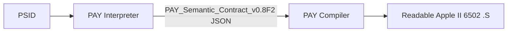

# PAY Semantic Contract v0.8F2

## One API boundary, two tools



The Interpreter owns all static and runtime source evidence, GPT/manual interpretation, and candidate review. The Compiler owns a typed AY target capability catalog, target memory and IRQ policies, and assembly generation. **The previous Semantic Workbench is integrated into PAY Interpreter and no longer required.**

## Contract object

```json
{
  "format": "PAY_Semantic_Contract_v0.8F2",
  "source": {"sha256PSID": "<sha256 of original .sid file>", "fileName": "..."},
  "mechanismId": "player_entry",
  "intents": [{"operation": "PLAYER_INIT", "inputs": [], "outputs": [], "evidenceIds": [], "status": "candidate"}],
  "candidate": {"format": "PAY_Semantic_Candidate_v0.8", "...": "see original candidate"},
  "evidence": {"format": "PAY_Semantic_Evidence_v0.8", "...": "bounded source evidence"},
  "validation": {"structure": "passed", "semanticReview": "needs_human_validation", "compilerApproval": false},
  "compilerModule": null,
  "targetPolicy": {"noZeroPage": true, "noSelfModifiedCode": true},
  "limitations": []
}
```

`intents` describe what the model believes the source program does; these are not arbitrary assembly statements. `evidence` contains source instruction bytes and executed flows rather than just a list of SID writes. `compilerModule` is null for unsupported semantics. For source-specific verified functions, it may carry a strictly typed and source-checked partial projection, without claiming independent human review.

A structural validator only checks identifiers and source dependencies, **not** the correctness of all candidate statements. A separate source-aware lowering applies deterministic checks before creating a supported projection. The compiler rechecks evidence, source identity and capability. A research fixture is not an approved music conversion.

## Current 00.8F2 capability

- Supported source: exact Bomberland PSID SHA-256 `65c3874b9f529c9adac45852f6e216eef2307a325051471d8b58290c38f71a68`.
- Supported source mechanism: `player_entry`; source `A` 0,1,2 -> setup index 0,3,6, first-PLAY switch, later-PLAY switch.
- Supported target: Apple II / physical Mockingboard slot 4, state in absolute RAM, `ORG $6000`, 50 Hz external tick assumption.
- No AY score events, source tables, note tokens, full PLAYER_TICK body, instrument/effect mapping, or song looping.
- Compilations from the browser remain **silent, unapproved research fixtures**.

## Failure behavior

The Compiler must refuse a contract for a mismatched source hash, absent mandatory source operand references, unimplemented operation, changed stride, or missing typed projection. A contract's `compilerApproval:false` must never be interpreted as production authorisation. The UI deliberately exposes its fixture-only mode.

## Test evidence

End-to-end browser test with the original 12 MB Bomberland Complete Report: extraction yields 978 indexed records and five investigation groups. The generated PSID SHA-256 matches the original source. The reviewed-example candidate passes structural checks, the exported contract imports into the Compiler, and the Compiler emits the silent v0.8F assembly. Negative tests reject source mismatch, changed arithmetic, missing claim references and null typed projection.

**The user's latest pasted candidate is not automatically reviewed or proven by these tests.** In particular, some prose refers to first-PLAY `$00` without qualifying the selected subtune; in general the source arithmetic yields 0,3,6. Nor should `$10F6`, `$1129`, or `$1162` be classified as pattern tokens.
