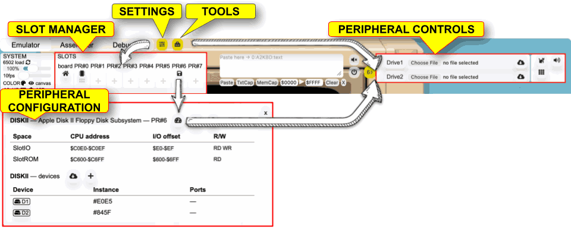

# Peripheral cards and the Slot Manager — User Guide

RetroAppleJS emulates Apple II expansion cards (**peripherals**) and, for some cards, attached **devices** such as disk drives or sound engines. This manual explains where to find the Slot Manager, how to change a slot, and where to operate a mounted card.

**Quick route:** **Emulator → Settings** (sliders icon) for the slot layout; **Emulator → Tools** (toolbox icon) for **Peripheral controls**.



## 1. Slot Manager: install, inspect, move and eject

1. Open the **Emulator** tab and click **Settings** (the sliders icon).
2. Find the **slot layout**. Installed cards display their pictogram/name; empty slots offer an **add (+)** button.
3. Click an installed card to inspect its **slot details**. Click the **+ on an empty slot** to open **ADD PERIPHERAL**.
4. Close a popup using its **×** control.

Slots labeled `PR#0`–`PR#7` are physical Apple II peripheral slots. The **board** is shown separately. Which slots are available depends on the configured machine. In the current default Apple II+ layout, a language card may occupy `PR#0` and Disk II occupies `PR#6`; a different configuration or a launch URL can override defaults.

> **SCREENSHOT PLACEHOLDER U02 — Slot layout.** Capture the full Slot Manager showing board, PR#0–PR#7, an installed Disk II card and an empty slot's plus icon. Suggested filename: `docs/assets/PERIPHERALS-U02-slots.png`.

### Add a peripheral

Click **+ on an empty slot**, locate a card by its short code (for example `MOCK`, `DISKII`, `SPC` or `DITHER2`), and click the **+ inside its label**. The card appears in the slot layout. Entries shown **greyed out** are not available in the current context; for example the slot may be incompatible or the card may be fixed/locked. Mounting is also checked against the chosen Apple II system.

> **SCREENSHOT PLACEHOLDER U03 — ADD PERIPHERAL.** Show the complete picker, with both an available choice and a greyed-out choice. Suggested filename: `docs/assets/PERIPHERALS-U03-picker.png`.

### Inverse colors identify the usual slot

Some Apple II titles assume a particular card slot rather than detecting it. When opening the Add Peripheral picker for that slot, an **inverse-colored label** (dark background, light text) identifies a card for which this is the **preferred/usual** location. The complete label—plus, pictogram and code—is highlighted.

This is a **recommendation, not a restriction or an automatic installation**. For example, `DITHER2` is compatible with slots 1–7, but the configuration string `1,2,3,4,5,6,7$` makes **slot 7** the preferred one. In the configuration master, `*` means *automatically pre-install*; `$` means *highlight the usual slot*. They can be combined.

> **SCREENSHOT PLACEHOLDER U04 — Preferred slot comparison.** Capture ADD PERIPHERAL for PR#7 showing DITHER2 in inverse colors, alongside PR#6 showing DITHER2 normally. Suggested filename: `docs/assets/PERIPHERALS-U04-preferred.png`.

### Move or eject a card

- **Move:** drag an installed card by its drag handle to an **empty, compatible** slot. Locked cards are not movable.
- **Eject:** click an installed card, then use **Eject peripheral** in its details popup. Locked cards cannot be ejected.
- **Inspect:** the same details popup shows card identification, mapped address spaces, read/write handlers and any attached devices.

After moving a peripheral, software already running may still refer to its old slot address. Reload or restart the Apple II program if necessary.

> **SCREENSHOT PLACEHOLDER U05 — Slot details and move.** Show the drag handle and the slot-details header containing the gauge (Peripheral control), Download slot JSON and Eject buttons. Suggested filename: `docs/assets/PERIPHERALS-U05-details.png`.

## 2. Find the controls for an installed card

**Slot management** is separate from **peripheral controls**.

**From Settings:** click an installed card, then click the **Peripheral control** **gauge/tachometer icon** in its slot-details popup. This changes to **Emulator → Tools** and selects that card's controls.

**From Tools:** click the **Tools** toolbox icon in the Emulator toolbar. Find the **Peripheral controls** slot selector. Click it to cycle through mounted cards. The toolbox below follows the selected card.

Controls differ by peripheral. For example, Disk II exposes drive-related controls and Mockingboard exposes sound controls; memory expansion cards can expose bank/memory monitoring. Some cards provide very few controls.

> **SCREENSHOT PLACEHOLDER U06 — Peripheral controls.** Capture the gauge button in slot details and a second view of the Tools popup with the active slot selector and card controls. Suggested filename: `docs/assets/PERIPHERALS-U06-controls.png`.

### Import files into a Disk II drive

With the Disk II controller selected under **Peripheral controls**, use the **Upload** pictogram (second row, beside the Disk Surface Map button). The popup is the same size as the surface map and can be toggled with the upload button. Select a drive with a mounted **DOS 3.3** disk, then select a host file.

- **Binary (B):** specify a load address (for example `$2000`). The importer stores the DOS binary header and refuses an image whose bytes would extend beyond `$FFFF`. This imports a file onto the disk; it does not immediately write to Apple II RAM.
- **Text (T):** UTF-8 input is converted into Apple II high-bit character bytes with CR line endings and a DOS text-file terminator. Character presets are approximate; unsupported characters are replaced.
- **Applesoft BASIC source:** **not supported by disk import**. Paste numbered BASIC source through the existing emulator **Paste** control while the Apple II is running. Applesoft handles its own tokenization.

The importer requires a recognized 35-track, 16-sector DOS 3.3 volume. It writes DOS logical sector positions directly to the `.dsk` image; the Disk II controller performs physical-sector interleave during nibblization. Older importer versions double-applied the skew and could create a catalog-visible binary whose stored DOS header appeared as `$0000`/zero length when loaded by DOS. Stop the relevant drive before importing. Existing filenames are not overwritten. The import changes the currently mounted disk image, which can subsequently be saved with the drive's normal **Save disk** control. The importer verifies the saved file contents after Disk II nibblization and reports the DOS binary header's load address and data length; a failed read-back causes the image change to be rolled back. This verification does not test the live Apple DOS BLOAD command. It also confirms that the DOS 3.3 VTOC marks each imported file sector allocated (DOS numbers sector `$F` at the first bitmap bit and sector `$0` at the last). If an older importer version already modified a disk using the reversed bitmap, mount a fresh unmodified DOS 3.3 image before retrying; do not rely on that previous import. ProDOS and nonstandard copy-protected disk layouts are not supported.

### Peripheral cards are not attached devices

A **peripheral** is the slot-mounted controller. A **device** is a unit that the controller manages, such as a disk drive. Not every card exposes attachable devices.

For cards that do:

1. In **Settings**, click the **mounted card** to open slot details.
2. Look beneath the mapping table for the **devices** table: device, instance and ports.
3. Use **Attach device (+)** if enabled; this opens a *device picker*, not the Add Peripheral picker.
4. Click an attached device's label to inspect its instance. Depending on the implementation, you may be able to change its unit number or detach it.
5. **Download device JSON** exports device metadata for diagnostics—it does **not** save a disk image.

> **SCREENSHOT PLACEHOLDER U07 — Devices.** Capture a controller's devices table, Attach device (+), and one selected device's controls. Suggested filename: `docs/assets/PERIPHERALS-U07-devices.png`.

## 3. Reading the slot address map

The **slot details** display active CPU address ranges and their **RD** (read) and **WR** (write) callbacks. These describe the emulator's memory-mapped interface; they are mainly useful for troubleshooting.

| Name in details | Typical Apple II CPU addresses | Meaning |
| --- | --- | --- |
| **HostIO** | `$C000–$C07F` | Built-in motherboard keyboard, speaker and other I/O. |
| **SlotIO** | `$C080–$C0FF` | Eight 16-byte regions; for example slot 6 uses `$C0E0–$C0EF`. |
| **SlotROM** | `$C100–$C7FF` | A 256-byte window per slot 1–7; may contain firmware **or registers**. |
| **HostROM** | `$C800–$CFFF` | Shared 2KB expansion firmware window, selected by the active peripheral. |
| **Dynamic mapping** | e.g. `$D000–$FFFF` | ROM/RAM overlays supplied by a memory expansion card. |

A name such as *SlotROM* denotes a CPU address **window**, not proof that an actual ROM chip is present.

> **SCREENSHOT PLACEHOLDER U08 — Mapping table.** Capture a card's Space, CPU address, I/O offset and R/W columns. Suggested filename: `docs/assets/PERIPHERALS-U08-mapping.png`.

## 4. Preselecting cards at launch

A launch URL can select a layout **before** the Apple II boots, replacing individual pre-filled settings without changing the configuration source:

```text
index.html?slots=2:SPC,4:MOCK,6:DISKII
```

Numbers mean **physical slots**, followed by each card's **PCODE**. `slots=6:NONE` leaves slot 6 empty. The `$` marker is **not** part of a URL: use `slots=7:DITHER2`, not `slots=7$:DITHER2`. Other unspecified defaults stay in place unless their card has been moved by the URL.

See [URL Arguments: Pre-mounted peripherals](https://github.com/RetroAppleJS/RetroAppleJS.github.io/blob/main/docs/URL_ARGUMENTS.md#pre-mounted-peripherals-slots) for the exact behavior and more examples.

> **SCREENSHOT PLACEHOLDER U09 — URL and resulting layout.** Show a launch URL and the Slot Manager after boot. Suggested filename: `docs/assets/PERIPHERALS-U09-url.png`.

## 5. Troubleshooting

| Problem | Check |
| --- | --- |
| A card is greyed out in ADD PERIPHERAL | The slot is occupied/locked, the card cannot move, or the card is not compatible with this slot/system. |
| A title fails to find an installed peripheral | Does the software assume a particular slot? Try the inverse-highlighted **preferred** slot or consult the title's instructions. |
| You cannot find the peripheral's buttons | **Settings → card → Peripheral control (gauge)**, or **Tools → Peripheral controls** selector. |
| A drive or unit is missing | First mount its **parent card**, then inspect the card's attached **devices**. |
| Several cards fail at startup | Read the **single Peripheral compatibility warnings** popup and click **Acknowledge** after reviewing all entries. |
| A card moved but the program still fails | Restart or reload the software so it can use the new slot. |

For ROM analysis and implementing new card types, see the [Peripheral Developer Reference](https://github.com/RetroAppleJS/RetroAppleJS.github.io/blob/main/docs/PERIPHERALS_DEV.md).
