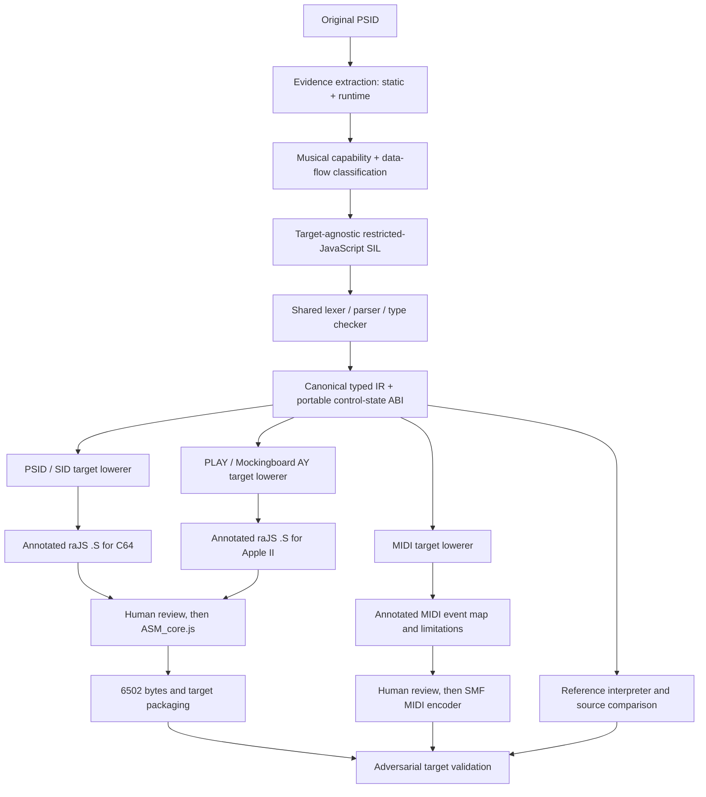
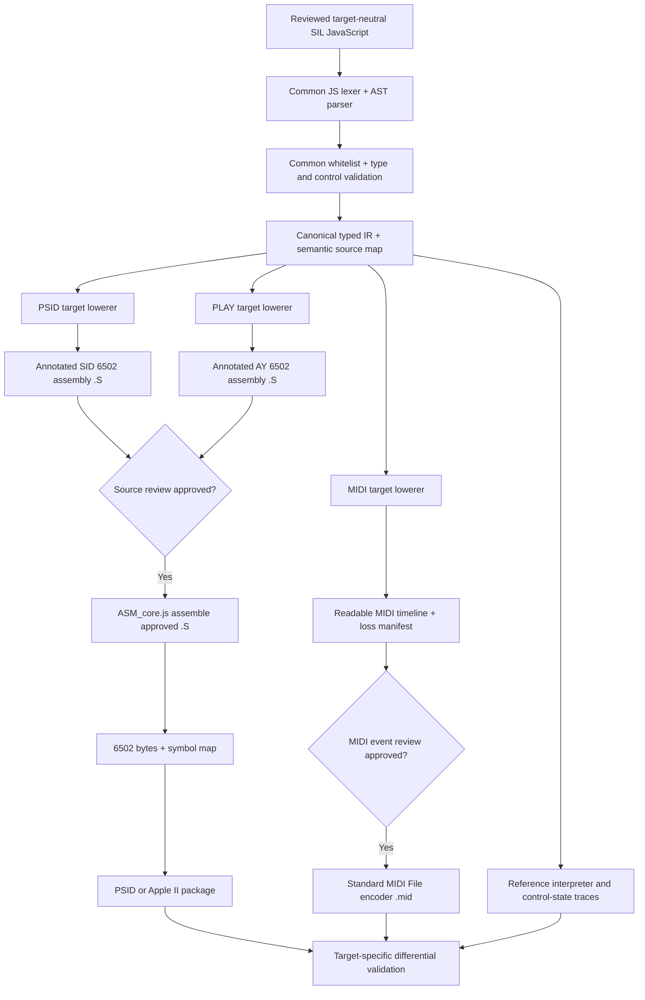

# PLAY Semantic Intermediate Language (SIL)

**Design specification — source-faithful capabilities and controls, target-agnostic restricted JavaScript, deterministic typed IR, and separate PSID / PLAY / MIDI compilation backends**

| Attribute | Value |
|---|---|
| Status | **Proposed architecture — for review; not a validated Bomberland contract** |
| Scope | PSID → regenerated PSID; PSID → PLAY (Apple II / Mockingboard / AY); optionally PSID → MIDI or another explicitly specified output |
| Goal | Reconstruct the musical **intent and algorithms**, not merely transcribe 6502 instructions or replay SID register-write recordings |
| Inputs | PSID binary, static code and data analysis, bounded runtime traces, indexed evidence, human review |
| Outputs | Evidence-linked musical intent, **target-agnostic restricted-JavaScript SIL**, common typed IR and control-state/event traces; **target-specific** reviewed `.S` + 6502 binaries for PSID/PLAY, or MIDI event map + `.mid` for MIDI; validation reports for each target |
| Design baseline | Prior `PAY_Semantic_Contract_v0.8F2` is research evidence, **not** a sufficient executable musical specification |
| Revision | **v0.5.2** — Adds a verified glossary/resource chapter while retaining the v0.5.1 architecture: SIL and its lexer/parser/type checker are **target-independent**; target-specific lowerers emit reviewed `ASM_core.js`/raJS `.S` for 6502 (PSID/PLAY), or an annotated MIDI event timeline + Standard MIDI File (`.mid`) for MIDI. Target requirements and losses belong in backend manifests, not SIL source. |

## 1. Architectural decision

A typical PSID contains **musical data**, an executable **music program**, and accesses to **SID hardware**. These are different semantic layers:

1. **Layer A — native SID synthesis**: the hardware capabilities available when registers are configured.
2. **Layer B — PSID software algorithms**: sequencing, counters, conditional logic, calculated modulation, state machines, tables, jump tables and arbitrary instrument macros.
3. **Layer C — musical score**: voices, notes, rests, duration, patterns, order, repeats, instrument/effect commands and arrangement.

A fourth concern, **target-specific lowering**, must remain separate from all three source layers. A target does not get to redefine what the original PSID meant.



**Key rule:** a SID write describes a hardware **effect**. It is *not* in itself evidence of the musical **cause** (e.g., vibrato, a pitch slide, a new note, an instrument macro or a filter sweep).

### Multiple output routes, one semantic source

| Route | Purpose | Required guarantees |
|---|---|---|
| **PSID → PSID** | Independently rebuild the score/player and perform adversarial equivalence tests against the original | No embedded recorded SID-write stream; preserve original algorithmic state transitions where claimed; label approximations |
| **PSID → PLAY** | Lower the same intent into an Apple II player and its available sound hardware | Explicit target capability matrix; deterministic mapping or acknowledged emulation; do not silently claim SID-native facilities exist on AY |
| **PSID → MIDI** | Convert score/transport and representable automation into Standard MIDI File events | Explicit note/tempo/channel mapping; validate continuous-time sampling and acknowledge that native SID waveform, ring modulation, shared analog filter, and other chip-level behaviours have no guaranteed lossless MIDI equivalent |

The **same** intermediary SIL, typed state model, named effect functions and bespoke macro algorithms must be accepted regardless of output selection. Target limitations are resolved *after* semantic parsing, not by altering the music program. **6502-targeted backends** must emit inspectable annotated source in the actual `res/ASM_core.js` dialect before bytecode. The **MIDI backend** instead emits a reviewable event/automation timeline before encoding MIDI bytes.

### 1.1 Portability boundary — source semantics versus implementation

- **SIL owns:** musical intent, source-proven tick/counter semantics, control variables, algorithmic state, function arrays and dispatch, arithmetic widths and order of operations, and the evidence explaining those choices.
- **The common SIL front end owns:** JavaScript lexical analysis, AST parsing, syntax whitelisting, type checking, control-flow analysis, canonical typed IR, portable reference execution and semantic diagnostics. It receives **no target platform option that changes the AST meaning**.
- **The target backend owns:** output representation, clock conversion, playable-voice allocation, hardware register mapping, storage/CPU budgets, instruction selection or MIDI event encoding, approximation/unsupported decisions and target-specific validation.
- **The 6502 backend alone owns:** `ORG`, memory maps, branch relaxation, `JSR`/`JMP`, self-modifying code policy, `raJS` syntax, and the `ASM_core.js` invocation. Those are not SIL language constructs.
- **The MIDI backend alone owns:** PPQN/tick conversion, tempo map, channels, instruments/patches, note events, pitch bend and CC mappings, controller resolution, and SMF encoding. It may reject or label unrepresentable hardware-level behaviours; it must not quietly erase them.

**Important nuance:** Parsing JS syntax is shared. What differs by target is the **subsequent compilation/lowering of the parsed, typed program**. Two unrelated JS parsers with different semantics would make PSID→PSID and PSID→PLAY comparisons unreliable.

### 1.2 Stable semantic controls versus source-specific physical units

A portable control must describe its **meaning and units**, not blindly inherit a SID register width. For instance, a musical pitch may be expressed as a note plus fine-pitch offset or an explicit frequency with a declared unit and quantization policy. The original SID frequency word can also be preserved as **source-exact evidence/state**, but it must not be the *only* interpretation of pitch. Likewise, a source ADSR register value is not a universally equivalent target envelope; both its semantic envelope role and any SID-specific behaviour needed for fidelity must remain identifiable. Only the selected target backend converts these controls to SID frequency words, AY tone periods or MIDI note/pitch-bend events. Where such conversion is inherently lossy, record it. Reject unknown units and rounding policies.

## 2. Layer A — SID hardware catalogue

The SID has three oscillators and envelope generators, plus a shared analog filter. **Hardware registers are implementation destinations, not the source intermediate language.**

| Capability ID | Native SID capability | Canonical output controls | Physical SID destination |
|---|---|---|---|
| `sid.osc.frequency` | 16-bit oscillator frequency | `voice[v].frequencyWord` | `$D400/01 + 7v` |
| `sid.osc.waveform` | Triangle / saw / pulse / noise and combinations | `voice[v].waveformMask` | `$D404 + 7v`, upper nibble |
| `sid.osc.pulse_width` | 12-bit pulse width | `voice[v].pulseWidth` | `$D402/03 + 7v` |
| `sid.osc.gate` | Gate on/off | `voice[v].gate` | `$D404 + 7v`, bit 0 |
| `sid.osc.sync` | Hard synchronization from neighboring oscillator | `voice[v].sync` | `$D404 + 7v`, bit 1 |
| `sid.osc.ring_mod` | Ring modulation of triangle waveform | `voice[v].ring` | `$D404 + 7v`, bit 2 |
| `sid.osc.test` | Oscillator test/reset behaviour | `voice[v].test` | `$D404 + 7v`, bit 3 |
| `sid.env.adsr` | Per-voice attack, decay, sustain, release | `voice[v].adsr.{attack,decay,sustain,release}` | `$D405/06 + 7v` |
| `sid.filter.cutoff` | **Shared** filter cutoff | `global.filter.cutoff` | `$D415` / `$D416` |
| `sid.filter.resonance` | Shared resonance | `global.filter.resonance` | `$D417`, upper nibble |
| `sid.filter.routing` | Voice/external-input filter selection | `global.filter.routeMask` | `$D417`, lower nibble |
| `sid.filter.mode` | Low-pass / band-pass / high-pass selections | `global.filter.modeMask` | `$D418`, mode bits |
| `sid.mixer.master_volume` | Four-bit master volume | `global.masterVolume` | `$D418`, lower nibble |
| `sid.mixer.voice3_off` | Suppress voice 3 direct output | `global.voice3Off` | `$D418`, bit 7 |
| `sid.readback` | Pot inputs and oscillator 3/envelope 3 readback | `input.sidReadback` | `$D419–$D41C` |
| `sid.chip_model` | SID 6581/8580 characteristics | `environment.sidModel` | Target/emulator metadata |

The filter is shared across the three voices: software may change **routing** and the filter's shared state, but cannot set three independent SID filter cutoff values on one chip. A PSID can also rely on model-dependent analog behaviour; that must be captured as a fidelity constraint rather than a generic numerical guarantee.

When compiling for AY hardware, the compiler must consult an AY/Mockingboard manifest. Any SID-only capability (for instance, the SID filter or SID per-voice ADSR) requires a **declared emulation strategy, a measurable approximation, or an explicit unsupported result**.

## 3. Layer B — PSID software capability catalogue

A PSID program does **not** drive separate hardware LFO units. It **emulates modulation generators in software** using arithmetic, counters, lookup tables, branches, comparisons and state. Their outputs modify SID hardware parameters on subsequent writes.

### 3.1 Transport, scheduling and score control

| Capability ID | Human-readable intent | Core state / operations | Proposed SIL function |
|---|---|---|---|
| `player.init` | Initialize selected tune and its voices | Subtune selection; reset state | `initSong(ctx, subtune)` |
| `player.clock` | Advance the program's source-defined timebase | PAL/NTSC/CIA/raster/external clock; tick divisors | `advanceClock(ctx, sourceTicks)` |
| `player.tempo` | Control musical step rate | Tempo counters, divider, swing if proven | `advanceTempo(ctx)` |
| `voice.scheduler` | Advance voice independently as time expires | Per-voice wait/reload, state transitions | `tickVoice(ctx, v)` |
| `score.fetch` | Fetch an encoded score command | Pattern pointer, offset, stream boundary | `fetchCommand(ctx, v)` |
| `score.decode` | Interpret command classes and parameters | Decoder state, byte classes | `decodeCommand(ctx, v, token)` |
| `score.note` | Trigger or hold a pitch | Note index, transpose, gate policy | `applyNote(ctx, v, note)` |
| `score.rest` | Express silence/rest/continuation | Gate and wait state | `applyRest(ctx, v, ticks)` |
| `score.instrument` | Select instrument definition | Instrument ID, macro initialization | `selectInstrument(ctx, v, id)` |
| `score.order` | Choose next pattern/section | Order index, pattern index, pointer | `advanceOrder(ctx, v)` |
| `score.loop` | Repeat a local/pattern/section/song range | Loop counter, start/end, nesting | `stepLoop(ctx, scope)` |
| `score.branch` | Conditional change in score/control flow | Predicate, branch target | `branch(ctx, predicate, target)` |
| `program.dispatch` | Select among program behaviours | Jump table, selector, handler address/ID | `dispatch(ctx, table, selector)` |
| `program.state_machine` | Multi-phase behaviour and decisions | Current state, transition conditions | `transition(ctx, machine)` |
| `program.patching` | Source self-modification semantics | Dynamic operand or code mutation | `updateSemanticState(ctx, field, value)` |
| `program.subroutine` | Reusable program behaviour | Call arguments, saved state, return | `invokeHandler(ctx, id)` |

**Important:** an executed CPU loop is not automatically a musical loop. Classify separately: polling loops, math loops, stream repeats, pattern repeats, order jumps, song loops, nested loops and dispatch cycles.

### 3.2 Named synthesis and modulation algorithms

| Capability ID | Music/synthesis name | Mathematical or logical operation | Control destination | Proposed SIL function |
|---|---|---|---|---|
| `fx.transpose` | Transposition | Fixed semitone/scale-index offset | Base pitch | `transpose(ctx, v, semitones)` |
| `fx.arpeggio` | Arpeggio | Cycle through discrete pitch offsets | Frequency | `stepArpeggio(ctx, v, spec)` |
| `fx.portamento` | Portamento | Ramp toward target pitch/frequency | Frequency | `stepPortamento(ctx, v, spec)` |
| `fx.pitch_slide` | Pitch bend/slide | Accumulate frequency offset each tick | Frequency | `stepPitchSlide(ctx, v, spec)` |
| `fx.vibrato` | Vibrato | Periodic software waveform / table lookup | Frequency | `stepVibrato(ctx, v, spec)` |
| `fx.tremolo` | Tremolo | Periodic amplitude-control calculation | Volume or emulated voice amplitude | `stepTremolo(ctx, v, spec)` |
| `fx.pwm` | Pulse-width modulation | Periodic/ramped duty-cycle calculation | Pulse width | `stepPWM(ctx, v, spec)` |
| `fx.filter_sweep` | Filter sweep | Ramp or nonlinear cutoff trajectory | Filter cutoff | `stepFilterSweep(ctx, spec)` |
| `fx.filter_lfo` | Periodic filter modulation | Phase accumulator and lookup/function | Cutoff/resonance | `stepFilterLFO(ctx, spec)` |
| `fx.envelope_software` | Software envelope | Time-dependent shaping beyond SID native ADSR | Volume, gate or other controlled parameter | `stepSoftwareEnvelope(ctx, v, spec)` |
| `fx.retrigger` | Retrigger / staccato | Periodic gate transitions | Gate | `stepRetrigger(ctx, v, spec)` |
| `fx.delay` | Delayed activation | Wait/counter and conditional action | Any permitted parameter | `stepDelay(ctx, scope, spec)` |
| `fx.instrument_macro` | **Bespoke instrument macro** | **Arbitrary permitted stateful algorithm** | One or several controls | `runInstrumentMacro(ctx, v, macroId)` |

A named capability earns its name **only when its algorithm, activation, timing, state evolution and parameter targets are evidenced**. A cyclic frequency write is a *candidate* vibrato, not automatically proven vibrato. A filter-register write is not automatically a filter sweep.

### 3.3 Cross-cutting programming capabilities

| Mechanism | What it provides | Typical use |
|---|---|---|
| Counters and timers | Local state advances across ticks | Note duration, effect speed, envelope step |
| Arithmetic and bit operations | Controlled transformations | Phase, frequency step, waveform calculations |
| Boolean comparisons | Decisions and predicates | Zero counter? end of note? trigger effect? |
| Conditional branches | Alternative algorithms | First tick, gate release, effect mode |
| Iterative loops | Repeated calculations | Decoding, math, table walking, instrument macros |
| **Jump tables and computed dispatch** | Select handler or destination by index/state | Effect command handlers, pattern routing, macro steps |
| Indexed data tables | Constant values or mutable indexed state | Frequency words, envelopes, waveform lookup |
| Indirect addressing/pointers | Fetch score/instrument/table data | Stream decoder, variable table pointer |
| Nested loops and state machines | Structured, stateful program behaviour | Score loops, stepped instrument programmes |
| Self-modified operands/code | Source technique **and optional 6502 backend strategy** | Dynamic `JSR`/`JMP` targets, patched constants, decoder state; preserve semantics and validate patch safety |

This catalogue is **open-ended**. Known capabilities compile through typed, reviewed functions. Other algorithms compile through the restricted SIL subset; **lack of a familiar synthesis name is not a reason to discard a source algorithm**.

## 4. Layer C — musical score model

The score contains **data and activation commands**, not the implementation of an oscillator or modulation function.

| Score entity | Required fields | Distinctions to preserve |
|---|---|---|
| Song / subtune | ID, name, initial order/patterns, clock selection | Multiple independent subtunes |
| Voice / track | ID, source channel, stream/order selection | Concurrent musical timelines |
| Note | Pitch token/index, onset, duration or hold rule | Base note vs frequency modulation |
| Rest / hold / tie | Token, gate decision, time rule | Rest ≠ release ≠ continuation |
| Instrument reference | Instrument ID, selection/restart rule | Instrument definition vs program execution |
| Pattern | ID, data/address range, decoded commands | Data content vs execution order |
| Order list | Next-pattern references and transitions | Repetition and branch destinations |
| Effect assignment | Capability ID or macro ID, parameters, start/stop | Named effect vs bespoke algorithm |
| Repeat | Scope, count, reset rules, destinations | Local repeat vs pattern repeat vs whole-song loop |
| Conditional command | Predicate/selector, destinations | Score decision vs CPU branch detail |

Pattern order may itself be represented as an **indexed table of data references**. That is not necessarily a jump table of executable handler addresses. The distinction is covered next.

## 5. Jump tables: first-class semantic objects

**Jump tables are fundamental**, not an implementation afterthought. PSID players often use indexed tables to select command handlers, instrument steps, effect processors or the next pattern. The Interpreter must preserve **what is being selected**, **why** and **what state controls selection**.

### 5.1 Classification

| Table category | Contains | Semantic action | SIL representation |
|---|---|---|---|
| **Code jump table** | Handler/program addresses | Transfer execution to one of several algorithms | `dispatch(tableId, selector)` |
| **Function-reference array / call table** | Ordered callable handler references, optionally wrapped as statically defined anonymous functions | Invoke one selected handler or iterate over handlers and return to the caller | `HANDLERS[index](...)` / `for (...) HANDLERS[i](...)` |
| **Mutable code jump table** | Writable handler vectors/operands | Change future execution route | Mutable `dispatchState` + `dispatch(...)` |
| **Pattern-order table** | Pattern IDs or data pointers | Select the next score section | `selectPattern(order[orderIndex])` |
| **Instrument/effect table** | Definitions, step offsets, macro IDs | Select an instrument or macro program | `selectInstrument(...)` / `runInstrumentMacro(...)` |
| **Value lookup table** | Numeric constants/waveform/frequency values | Return a value; **no control-flow transfer** | `lookup(tableId, index)` |
| **Indirect stream-pointer table** | Data addresses | Point the decoder to a new stream | `setStreamPointer(...)` |

These categories must not be collapsed into a generic `LOOKUP` or `DISPATCH_STATE` unless the target's **meaning** is established.

### 5.2 Required jump-table semantics

Every dispatch table in the semantic model has:

- `tableId`, `kind`, `scope` (`global`, `voice`, `instrument` or `macro`).
- The **selector expression** and its data type/range.
- A bounded set of **entries** (`selector → handlerId`, `index → callableId`, or `selector → dataId`).
- A **default/out-of-range policy**: reject, no-op, explicit fallback or source-proven masking.
- Any **write/mutation rules** and the time at which they take effect.
- A definition of **call vs jump vs tail-dispatch vs return**, including whether control returns to the same tick. An indexed function call is normally **call-and-return**, not a tail jump.
- For function arrays, whether a single entry is selected or **all entries are invoked in order**; `TABLE.length` is a compile-time constant for a fixed table.
- Reset rules, recursion/re-entry limits and source evidence for each inferred target.

A source sequence such as an indirect `JMP`, a computed address, or a self-modified `JMP` operand is **evidence** that dispatch may exist. It is not proof of the dispatch table's musical purpose until selector derivation and targets are traced.

### 5.3 Source 6502 versus intermediary representation

Possible 6502 implementations include:

```asm
; Illustration only: jump through a selected 16-bit code vector.
; LO/HIGH tables or packed 16-bit vectors may be used by the source.
  LDA HANDLER_LO,X
  STA VECTOR
  LDA HANDLER_HI,X
  STA VECTOR+1
  JMP (VECTOR)
```

Or source code may patch operands of a `JMP` or a branch and later execute that modified instruction. **Self-modifying code is an optional target lowering strategy, not a source-semantic requirement.** The same SIL operation may compile to a patched `JSR`/`JMP`, a writable vector, a dispatch ladder or a non-SMC trampoline, depending on the backend policy.

> 6502 lowering detail: on original NMOS 6502 processors, indirect `JMP ($xxFF)` uses the famous page-wrap behaviour. A compiler must either avoid that vector placement or reproduce the correct source/target processor semantics. Relative branch distance also requires branch-relaxation/trampoline handling.

### 5.4 Restricted JavaScript form

```javascript
// Illustration: one bounded control dispatch; not a claim about Bomberland.
const EFFECT_HANDLERS = [
  'effect.none',
  'effect.pitch_slide',
  'effect.vibrato',
  'macro.instrument_07'
];

function stepEffect(ctx, voiceIndex) {
  const selector = ctx.voice[voiceIndex].effectCode;
  dispatch(ctx, EFFECT_HANDLERS, selector, voiceIndex);
}

// An equivalent compiler-friendly switch is also valid:
function dispatchEffect(ctx, voiceIndex, selector) {
  switch (selector) {
    case 0: return;
    case 1: return stepPitchSlide(ctx, voiceIndex, PITCH_SLIDE_SPEC);
    case 2: return stepVibrato(ctx, voiceIndex, VIBRATO_SPEC);
    case 3: return runInstrumentMacro(ctx, voiceIndex, 'macro.instrument_07');
    default: return rejectDispatch(ctx, 'unknown effect command');
  }
}
```

Function identifiers are **compile-time symbols**, not arbitrary JavaScript function objects constructed at runtime. `dispatch(...)` is a defined SIL intrinsic that the 6502 compiler may lower to a compare/branch chain or a machine-code vector table, whichever is correct and efficient.

A **pattern-order table** uses the same indexing principle but returns **pattern data**, not executable handler code:

```javascript
const ORDER = [3, 7, 3, 9];       // Illustrative score ordering.
function nextPattern(ctx, voiceIndex) {
  const v = ctx.voice[voiceIndex];
  v.patternId = lookup(ORDER, v.orderIndex);
  v.orderIndex = wrap8(v.orderIndex + 1);
}
```

The semantics of an **unknown selector** are not invented. An unresolved dispatch destination is a compiler-blocking obligation for any path claimed to be complete.

### 5.5 Function arrays as jump/call tables (important JavaScript idiom)

A familiar JavaScript representation of an **indirect call table** is an array of functions. This is semantically the same family of indexed code selection as an address-based 6502 dispatch table, although an *invocation* through a function reference usually **returns** to its caller rather than behaving like an unconditional machine-code `JMP`.

The following is the user's idiom, retained as **ordinary JavaScript syntax**:

```javascript
var array_of_functions = [
  function() { first_function('a string'); },
  function() { second_function('a string'); },
  function() { third_function('a string'); },
  function() { fourth_function('a string'); }
];

for (let i = 0; i < array_of_functions.length; i++) {
  array_of_functions[i]();
}
```

**Important semantic distinction:** this loop invokes **every** function in array order. To choose **one** handler by a decoded musical command instead, the source might use:

```javascript
const command = ctx.voice[voiceIndex].effectCode; // bounded selector
if (command < array_of_functions.length) {
  array_of_functions[command]();
}
```

Both patterns must be expressible: **indexed call** and **ordered visitation**. Neither should be converted automatically into a pattern-order data table or a pre-defined instrument macro.

#### 5.5.1 Restricted SIL representation

For deterministic 6502 compilation, we can accept *statically declared function-reference arrays*, and optionally **noncapturing anonymous function expressions** as array elements, provided the compiler lifts each expression into a distinct, named, fixed-signature handler. A runtime function object, closure allocation or unbounded callback environment is not required.

```javascript
// Restricted SIL syntax; handler references resolved at compile time.
const INSTRUMENT_STEPS = [stepAttack, stepShape, stepRelease];

function stepInstrument(ctx, voiceIndex) {
  const step = ctx.macro[voiceIndex].programCounter;
  // In v1 the compiler must prove or check step against fixed table bounds.
  if (step < INSTRUMENT_STEPS.length) {
    INSTRUMENT_STEPS[step](ctx, voiceIndex);
  }
}

function runAllSteps(ctx, voiceIndex) {
  for (let i = 0; i < INSTRUMENT_STEPS.length; i++) {
    INSTRUMENT_STEPS[i](ctx, voiceIndex);
  }
}
```

The **array order, argument evaluation, side-effect order and return semantics** are observable behaviours. They must be preserved. In particular, iterating through an array of callbacks is *not equivalent* to executing a single selected command; a backend cannot change one into the other for convenience.

#### 5.5.2 Anonymous functions, captured values and arguments

The original example includes four anonymous wrappers and a string argument. These have separate compilation considerations:

| JavaScript feature | Initial SIL treatment | Reason |
|---|---|---|
| `const handlers = [handlerA, handlerB]` | **Accept**: fixed function-reference table | Each function has a known signature and code symbol |
| `const handlers = [function(ctx,v){ ... }, ...]` | **Accept if noncapturing**; lift to generated named routines | No runtime closure environment is needed |
| Arrow function expressions `[(ctx,v) => ...]` | Optional syntax sugar for the same **noncapturing** static form | AST must normalize them; not a new runtime capability |
| Callback captures of outer *mutable* locals | **Reject in v1** unless explicitly represented in `ctx` | True closures need an environment and lifetime model |
| `handlers[index](ctx, v)` | **Accept** with bounded selector and compatible signatures | Indirect call rather than value-table lookup |
| `handlers.length` | **Accept** for statically sized tables, as a compile-time constant | No dynamic array object required |
| `handlers.push`, computed arbitrary handlers | **Reject** | Would require dynamic code/heap semantics |
| Replacing a table entry at runtime | **Only via an explicitly declared, bounded mutable handler-ID table** | All possible targets must be validated |
| `'a string'` as in the illustrative JS | **Metadata or compile-time constant only** in v1, not an arbitrary runtime string object | The target 6502 ABI currently supports integer/boolean/state arguments; dynamic string support would be a separate language extension |

If a genuine source algorithm requires **captured** values, represent them as explicit typed state/parameters or introduce a reviewed closure-environment extension. Do not silently discard captures. If string contents affect audible behaviour, the parser must either establish a supported encoding and ABI or reject that path as unsupported; it cannot silently delete the argument.

#### 5.5.3 6502 lowering: selected call vs tail jump

A fixed table of symbolic function IDs can be lowered as (1) a compare/branch sequence with `JSR` calls, (2) a ROM/RAM address-vector table plus a verified indirect-call trampoline, or (3) an inline sequence when doing so is semantically safe. The original 6502 has an **indirect `JMP` but no indirect `JSR`**; a call-table implementation must preserve the return address by using a trampoline or another correct calling convention. The compiler must ensure nested dispatch, stack depth, and return paths remain valid.

For every recovered function array, the Interpreter should record the **entry order, whether the operation is call/return or tail dispatch, argument binding, index bounds, table mutability, handler effects, and evidence for each reachable target**. This yields a programmable control-flow concept usable for decoded commands, instrument-step programs, effect processors, and callback chains.

### 5.6 Self-modifying `JSR` and `JMP` as first-class backend options

A writable 6502 instruction operand can hold the *current* destination of a call or jump. Because an absolute `JSR` (`$20`) and absolute `JMP` (`$4C`) each contain a **little-endian 16-bit address operand**, a program may modify the following two bytes to select a new handler. This is an important and often compact way to implement **function arrays, effect dispatch, macros, reusable handlers and multi-way branching**.

**Do not confuse the three distinct mechanisms:**

1. **Patched absolute instruction:** `JSR $1234` or `JMP $1234` with operand bytes subsequently rewritten in RAM. This is genuinely self-modifying code.
2. **Indirect jump:** `JMP (VECTOR)` (`$6C`) reads a two-byte vector in RAM. Changing `VECTOR` is ordinary data mutation, **not** instruction self-modification.
3. **Indexed function table:** code selects one of several constant/mutable handler addresses; it may lower to either strategy. The source table may be an array of addresses or a conceptual array of callable handlers.

#### 5.6.1 Dynamic call with patched `JSR`

```asm
; Illustrative 6502. The target code and operand bytes are in writable RAM.
; Handler selector X is checked before the two table reads.
DISPATCH_CALL:
    LDA HANDLER_LO,X
    STA CALL_SITE+1       ; low byte of JSR destination
    LDA HANDLER_HI,X
    STA CALL_SITE+2       ; high byte of JSR destination
CALL_SITE:
    JSR DEFAULT_HANDLER   ; operands are patched before execution
    RTS                   ; selected handler returns via RTS

HANDLER_LO:
    .BYTE <HANDLER_0,<HANDLER_1
HANDLER_HI:
    .BYTE >HANDLER_0,>HANDLER_1
```

`CALL_SITE+1` and `CALL_SITE+2` are the two bytes after opcode `$20`. With a validated target, the chosen handler's `RTS` returns to the instruction following `JSR`; the dispatch routine then returns to its caller. The assembler syntax for low/high address extraction may vary across supported assemblers.

#### 5.6.2 Dynamic tail dispatch with patched `JMP`

```asm
; Illustrative 6502: selected handler takes over control flow.
DISPATCH_JUMP:
    LDA HANDLER_LO,X
    STA JUMP_SITE+1       ; low destination byte
    LDA HANDLER_HI,X
    STA JUMP_SITE+2       ; high destination byte
JUMP_SITE:
    JMP DEFAULT_HANDLER   ; destination replaced at runtime
```

A `JMP` does **not** establish a return address. Its selected handler must satisfy the caller's control-flow contract: tail-dispatch return, continuation jump, or nonreturning transfer. Do not substitute `JMP` for `JSR` merely because both can be patched.

#### 5.6.3 Non-self-modifying alternative: indirect-call trampoline

```asm
; A standard 6502 has JMP (absolute), not JSR (indirect).
; First store the selected handler address into VECTOR_LO/VECTOR_HI.
CALL_SELECTED:
    JSR CALL_GATE         ; pushes return address for the original caller
    RTS
CALL_GATE:
    JMP (VECTOR_LO)      ; selected handler's RTS returns to CALL_SELECTED
VECTOR_LO:
    .BYTE $00
VECTOR_HI:
    .BYTE $00
```

The vector must occupy two adjacent readable bytes; this illustration uses consecutive bytes placed after code. The compiler must verify the precise return destination, vector placement and the original NMOS 6502 indirect-`JMP` page-boundary quirk. The trampoline avoids modification of executable instructions and is useful when the target code is ROM-backed or write-protected.

#### 5.6.4 Backend selection and correctness constraints

| Requirement | Rule |
|---|---|
| Semantic independence | SIL expresses `handlers[index](...)`, `dispatch(...)` or an equivalent state transition, **never a raw patch offset** unless source code mutation itself is an observable, proven requirement |
| Backend modes | `selfModifyingCode = forbid | allow | prefer`; `prefer` is an optimization hint, not permission to change behaviour |
| Writable storage | Patch sites must reside in RAM writable at execution time; the loader, memory bank and address relocations must be validated |
| Target closure | Every target must resolve to a verified handler symbol or an explicitly guarded finite set; reject unknown/unbounded code addresses |
| Atomicity / interrupts | A two-byte operand patch is not atomic. Prevent execution during partial updates using proven scheduling, ownership, or appropriately safe critical sections; do not assume interrupts are absent |
| Shared call sites | Check reentrancy, nested callbacks and concurrent voice updates. A shared patch site cannot be overwritten between its preparation and execution |
| Calling convention | Preserve `JSR`/`RTS` stack behaviour, tail-jump semantics, register clobbers and return paths |
| Timing and footprint | Compare cycles, ROM/RAM bytes, vectors, patch writes and worst-case per-tick cost against non-SMC alternatives |
| Proof and debugging | Retain source-to-SIL-to-6502 maps; test every selector, handler, interrupt-sensitive path and patch-state transition |
| Execution cache | Standard NMOS 6502 does not require instruction-cache invalidation, but host emulators/translators must honor writable code and fetch updated bytes |

**Source-proven SMC vs generated SMC:** The attached Bomberland evidence includes instruction-operand patches such as `$1129` and `$1162`. These are evidence of mutable immediate operands/dispatch state, **not proof that Bomberland patches a `JSR` or `JMP` at those specific addresses**. Identify a patched call/jump only after verifying the opcode, patch writers, executed destination and selected handler semantics.

The compiler may intentionally **reintroduce** self-modifying dispatch in the generated 6502 even when the normalized SIL has no SMC constructs. Conversely, it may eliminate original SMC by translating it to typed state and indirect dispatch. Both are correct only when the same semantic behaviour and target constraints are preserved.

## 6. Canonical control variables: the shared runtime ABI

The SIL does **not** directly write `$D400`, `$D418`, AY registers or MIDI bytes. It updates a structured, typed **target-agnostic semantic control state**; target-specific codecs and hardware commits are handled after lowering. Where the source uses SID register-quantized values (such as a `frequencyWord` or `pulseWidth`), retain those as explicitly **source-native quantities or source-exact sidecar state**, alongside any portable musical interpretation. Do not mistake the source encoding for a universal target parameter.

**Formal separation of control namespaces:** use `ctx.music` and `ctx.synth` for universal musical intent and computed synthesis controls, and `ctx.source.sid` only for *source-exact* SID encodings or hardware constraints required for adversarial fidelity. A destination backend must not be given a direct dependency on `ctx.source.sid` register offsets as if those offsets were standard SIL language semantics. For example, `ctx.music.voice[v].pitch` is expressed with declared note/frequency units; an original SID 16-bit oscillator word is preserved in `ctx.source.sid.voice[v].frequencyWord` when evidence requires exact bit-level reproduction.

The following names are **proposed canonical names**, not asserted recovered source addresses. They form a stable **intermediate ABI** (application binary interface / contract between semantic interpreter and backends). The `ctx.modulator[v]` name used in an example below denotes an instance of the same statically allocated procedural state family as `ctx.macro[instanceId]`; its allocation and voice binding must be declared explicitly.

### 6.1 Time and transport (`ctx.transport`)

| Variable | Type | Meaning |
|---|---|---|
| `subtuneId` | `u8` | Current zero-based tune |
| `clockSource` | enum | `external`, `vblank`, `cia`, `raster`, `other_proven` |
| `clockNumerator/clockDenominator` | `u32` | Rational source call frequency, avoiding floating-point clock drift |
| `sourceCallCount` | `u32` | Number of source PLAY calls |
| `musicalTick` | `u32` | Source-meaningful musical tick (if proven) |
| `tempoPhase`, `tempoDivider` | `u16` | Source scheduling state |
| `orderIndex`, `patternIndex` | `u16` | Current song/pattern selection |
| `songLoopCounter` | `u16` | Source-proven whole-song repeats, if any |
| `running`, `finished` | `bool` | Transport state |

**Do not equate an external 50 Hz callback with a musical tick** without proving that relationship in the source.

### 6.2 Per-voice score and scheduling (`ctx.voice[v]`)

| Variable | Type | Meaning |
|---|---|---|
| `active` | `bool` | Voice is enabled/active |
| `streamId`, `streamOffset` | `u16` | Current source score stream and offset |
| `patternId`, `orderIndex` | `u16` | Voice-local order/pattern where applicable |
| `command`, `commandArgument` | `u8/u16` | Current decoded score command |
| `noteToken`, `noteIndex` | `u8/i16` | Raw note symbol and decoded pitch |
| `baseFrequencyWord` | `u16` | Fundamental pitch before procedural effects |
| `transpose` | `i16` | Score/instrument transposition |
| `waitTicks`, `durationTicks` | `u16` | Per-voice scheduler and note duration |
| `gateDelayTicks`, `releaseDelayTicks` | `u16` | Explicit articulation timing when source-proven |
| `noteOn`, `noteOff`, `retrigger` | `bool` | **Events** this tick; not the persistent gate value |
| `instrumentId`, `effectCode` | `u16` | Selected instrument and effect handler |
| `repeatStack` | bounded stack | Nested source-proven local or pattern repeats |
| `dispatchSelector`, `dispatchState` | `u8/u16` | Source-derived handler selection and mutable dispatch state |

Voice-specific scheduling counters must be independent where source evidence shows they are independent. Equal event rates cannot be presumed from a shared callback.

### 6.3 Per-voice synthesis and modulation (`ctx.synth.voice[v]`)

**Normative portable fields:** `pitch` (typed note/frequency + unit), `pitchModulation` (typed signed contribution + unit), `oscillator.waveform` (semantic selection), `oscillator.pulseDuty` (normalized duty or source-specific explicit unit), `envelope` (typed envelope intent), `amplitude` (intent, not a presumed SID voice-volume register), and `gate` (articulation state). The historically used `*Word`, 12-bit-width, nibble/bitmask and `6581/8580` fields in the following table are **source-exact SID quantities**. They must be stored under `ctx.source.sid` rather than treated as mandatory portable fields.

| Variable | Type/range | Meaning |
|---|---|---|
| `pitchBaseWord` | `u16` | Final base frequency from score/pitch table |
| `pitchOffsetWord` | `i32` (bounded) | Accumulated signed frequency deviation from effects |
| `pitchFinalWord` | `u16` | Output frequency after an explicit combination rule |
| `waveformMask` | `u8`, valid mask | Triangle/saw/pulse/noise selection |
| `pulseBaseWidth` | `u16`, `0..4095` | Instrument-defined duty cycle |
| `pulseOffset` | `i16` | Combined software modulation |
| `pulseFinalWidth` | `u16`, `0..4095` | Hardware output width after clamp/wrap policy |
| `gate`, `sync`, `ring`, `test` | `bool` | Native oscillator-control bits |
| `adsr.attack`, `.decay`, `.sustain`, `.release` | `u8`, `0..15` | SID native envelope parameters |
| `amplitudeIntent` | `u16` | Optional target-neutral software amplitude; **not** a native per-voice SID volume control |
| `controlDirtyMask` | bitmask | Which controls changed or require emission |

**Warning:** SID has no independent native linear *per-voice volume register*. `amplitudeIntent` must be lowered to an evidenced technique or emulation strategy on each target; do not claim it maps directly to an existing SID register.

### 6.4 Global synthesis (`ctx.synth.global`)

**Normative portable fields** include `masterGainIntent`, `filter.type`, `filter.cutoff` with declared physical/normalized units, `filter.resonance`, and `filter.routing`. The 4-bit SID master volume, 11-bit shared filter cutoff, `voice3Off` bit and `6581/8580` model identifiers shown below remain **source-hardware fidelity extensions** in `ctx.source.sid.global`; they are not mandatory controls for a MIDI or AY backend.

| Variable | Type/range | Meaning |
|---|---|---|
| `masterVolume` | `u8`, `0..15` | SID master volume |
| `filter.cutoff` | `u16`, `0..2047` | Shared SID filter cutoff |
| `filter.resonance` | `u8`, `0..15` | Shared resonance |
| `filter.routeMask` | `u8`, `0..15` | Voice/external filter routing |
| `filter.modeMask` | `u8` | Low-pass/band-pass/high-pass selection |
| `voice3Off` | `bool` | Suppress voice 3 direct output |
| `model` | enum | `6581`, `8580`, `unknown` |
| `chipCount`, `chipBase[]` | bounded | Multiple SID chips, when declared by source |

### 6.5 Procedural algorithm / instrument macro state (`ctx.macro[instanceId]`)

| Variable | Type | Meaning |
|---|---|---|
| `enabled`, `suspended` | `bool` | Macro execution lifecycle |
| `programId`, `pc` | `u16` | Selected algorithm and internal step/dispatch position |
| `phase`, `speedDivider`, `countdown` | `u16` | Software modulation phase and timing |
| `step`, `tableIndex` | `u16` | Current macro sequence position |
| `accumulator0..N` | typed integers | Source-proven arithmetic state |
| `conditionFlags` | bitmask | Source-proven decision state |
| `loopStack` | bounded stack | Macro loop counters and destinations |
| `scratch[]` | bounded typed array | Internal algorithm state; sizing declared |
| `resetOn` | enum flags | Instrument select, note on, explicit effect command, subtune start |

Each macro is explicit about **scope** (one voice, one instrument instance or global), **reset rules**, **tick order** and **when it can modify outputs**. Scratch arrays and counters are allocated statically, not by dynamic JavaScript object creation at runtime.

### 6.6 Per-tick control-resolution order

Different algorithms may affect one control. The SIL needs an explicit, evidence-backed conflict policy. A recommended default pipeline is:

```text
1. Consume source time / tick trigger
2. Advance song/pattern/voice scheduling and dispatch
3. Decode score commands and note/instrument events
4. Apply instrument resets and native parameter defaults
5. Step typed, named effects
6. Execute bespoke instrument macro(s)
7. Resolve control combinations (base + offsets + override priority)
8. Emit atomic target control changes (SID or PLAY/AY)
9. Update persistent state and commit trace for adversarial testing
```

**Per-tick versus persistent state:** reset per-tick contributions (such as `pitchOffsetWord`, `pulseOffset`, `noteOn`, `noteOff` and `controlDirtyMask`) before accumulating this tick's effects. Retain persistent instrument defaults, modulation phases and scheduler counters across ticks. Never inadvertently accumulate an offset twice because the contribution buffer was not cleared.

This is a **proposed execution order**; if the source program demonstrably does a different ordering (for example, modulation before command fetch), the semantic model must preserve the source's observable ordering.

A target backend may coalesce writes **only** where doing so does not change gate retrigger, oscillator test, envelope restart, filter behaviour or another observable transient. Repeated same-value writes can matter in some hardware or emulation contexts; do not blindly deduplicate them.

## 7. SIL language: a deliberately restricted JavaScript subset

The intermediary should look like **ordinary readable JavaScript**. Its meaning must be deterministic, statically analyzable and **target-independent**. It is a **language subset**, not an embedded general-purpose browser JavaScript interpreter. A valid SIL program has one meaning even if some backends cannot implement every feature. Eligibility for a particular 6502 memory/cycle budget is a **backend acceptance question**, not the definition of valid SIL.

### 7.1 Language philosophy and Turing completeness

A general imperative language with mutable state, decisions and unbounded iteration can express arbitrary algorithms in the usual idealized computation model. This is the key advantage over a fixed list of named musical effects.

However, no physical target with finite memory and real-time deadlines is literally unbounded or Turing-complete in the idealized sense. The **SIL semantic language** supports general algorithmic structure, with explicit integer/state semantics and a deterministic reference execution policy. A backend separately checks finite memory, stack, execution budget and target-specific loop/call bounds. A macro whose cost cannot fit a 6502 tick may still be a **valid SIL program** and may be usable by an offline MIDI renderer; it is **rejected for that 6502 target** rather than rewritten or silently truncated. The portable reference interpreter also enforces a configured execution budget to prevent runaway validation.

We should avoid making the accepted language *too weak* to represent real instruments. If a source algorithm cannot be represented because a particular expression or control structure is missing, add a **well-specified language construct** rather than inventing a new named synth effect for a one-off program.

### 7.2 Expressions and operators

| Group | JavaScript syntax accepted | SIL rule |
|---|---|---|
| Literals | `0`, `123`, `0xFF`, `true`, `false` | Integer and boolean only; integer literal bounds checked |
| Arithmetic | `+`, `-`, `*`, `/`, `%` | Typed integer semantics; overflow, division mode and zero division explicit |
| Bitwise | `&`, `\|`, `^`, `~`, `<<`, `>>`, `>>>` | Signedness and shift width explicit; no accidental JavaScript 32-bit coercion |
| Comparisons | `===`, `!==`, `<`, `<=`, `>`, `>=` | Strict typed comparison |
| Boolean | `&&`, `\|\|`, `!` | Short-circuit evaluation preserved |
| Conditional | `test ? a : b` | Both branch result types compatible |
| Assignment | `=`, `+=`, `-=`, `&=`, `\|=`, `^=` | Only to declared local or control-state fields |
| Increment/decrement | `++`, `--` | Allowed with explicit typed wrap/saturation policy |
| Indexed table access | `TABLE[index]`, `scratch[index]` | Bounded index; data array, pointer table and callable array are distinct types |
| Fixed table length | `TABLE.length` | Compile-time integer constant; only for statically sized arrays |
| Calls | `functionName(args)`, `HANDLERS[index](args)` | Declared functions/intrinsics; indexed calls only into fixed typed function-reference arrays |
| Parentheses | `(expression)` | Standard precedence, evaluation order |

An implementation can allow `*`, `/` and `%` but must account for their 6502 runtime cost. Special cases (powers of two, constants) should lower to efficient shifts or arithmetic. Arbitrary floating-point math, implicit fractional values and JavaScript `Number` edge cases are **not part of the default SIL semantics**.

For exact source arithmetic, use explicit types and helpers such as `wrap8()`, `wrap16()`, `asSigned8()`, `asSigned16()`, `clamp()` and `floorDiv()` rather than relying on JavaScript implicit conversions. Carry/borrow-sensitive 6502 idioms can be represented using typed arithmetic with a declared carry input/output when necessary.

### 7.3 Statements and control flow

| Statement | Support | Lowering consideration |
|---|---|---|
| `const`, `let` | **Yes** | Must have explicit/inferred fixed integer, boolean, array or struct type |
| `if / else` | **Yes** | Portable branching; each backend chooses its implementation |
| `switch / case / default` | **Yes** | Compare/branch chain or jump table; no fallthrough in v1 |
| `for` | **Yes** | Common semantic loop bounds/execution budget; each backend checks its own runtime constraints |
| `while` | **Yes, guarded** | Portable reference interpreter enforces budget; per-target termination and cost check |
| `do / while` | **Yes, guarded** | Same source semantics, backend budget may refuse |
| `break`, `continue` | **Yes** | Structured control-flow lowering |
| `return` | **Yes** | Declared return type; bounded call chain |
| `function` | **Yes** | Named top-level functions; noncapturing anonymous expressions in fixed function tables; no 6502 symbol rule in SIL |
| Arrays | **Yes, fixed size** | Read-only constants, fixed typed RAM, and fixed function-reference arrays with compatible signatures |
| `dispatch(...)` | **Yes** | First-class bounded jump/tail-dispatch intrinsic; distinguished from an indexed function **call** |
| `lookup(...)` | **Yes** | Data lookup, not transfer of execution |
| `goto` | **No in v1** | Prefer `switch`, jump-table dispatch or explicit state machine |
| Recursion | **No in v1** | Language-version choice for determinism; may be reconsidered independently of any one target |
| Exceptions / `try` / `throw` | **No** | Compile-time diagnostics and explicit result/status instead |
| Objects/classes/new | **No dynamic objects** | Fixed `ctx` structures and declared tables only |
| Strings | Metadata/compile-time identifiers only | No dynamic text operations in runtime SIL |
| `eval`, `Function`, imports | **No** | Determinism and sandbox integrity |
| Async, promises, timers, DOM, network | **No** | Runtime execution is driven only by source tick/callback |
| `Math.random`, `Date.now`, floating `Math.sin` | **No** | Nondeterministic or target-expensive; use explicit tables/algorithms |

**V1 language policy:** parse SIL with a real JavaScript AST parser or a purpose-built grammar; reject every unsupported syntax node, identifier and property path. Never generate machine code by regex substitution, and never `eval` GPT-generated text.

### 7.4 Numeric and memory model

Support at minimum:

- Scalars: `bool`, `u8`, `i8`, `u16`, `i16`, `u32`, `i32` as an explicitly declared bounded type system.
- Fixed-length `Array<u8|i8|u16|i16|...>` and immutable read-only tables.
- Fixed `struct` layouts for `transport`, `voice`, `synth`, `macro`, `dispatch`.
- Defined overflow modes: **wrap**, **saturate**, or **checked**. Defaults must be specified per operation, not guessed.
- Explicit shifts, sign extension, truncation and comparisons.
- Declared fixed-size state/tables and no implicit dynamic allocation in v1; **physical memory regions, alignment and bank layout belong to a backend**, not to SIL.
- A source memory read or write outside the modeled music-player state must be separately declared and verified.

A 6502 backend may use many machine instructions for one SIL operation (e.g., 16-bit addition or multiplication); a MIDI backend may instead evaluate that same operation offline and emit time-stamped MIDI events. “Basic JavaScript” is a **semantic source notation**, not a promise about any target instruction count.

### 7.5 SIL intrinsic API

All intrinsics have declared signatures and side effects. The following is the initial proposed library:

```typescript
// Types for documentation, not literal TypeScript runtime syntax.
type VoiceIndex = u8;            // bounded by source/target voice count
type TableId = string;           // compile-time symbol
type HandlerId = string;         // compile-time symbol
type MacroId = string;           // compile-time symbol

declare function wrap8(x: i32): u8;
declare function wrap16(x: i32): u16;
declare function clamp(x: i32, min: i32, max: i32): i32;
declare function asSigned8(x: u8): i8;
declare function asSigned16(x: u16): i16;
declare function floorDiv(a: i32, b: i32): i32;
declare function lookup(table: TableId | ConstTable, index: u16): i32;
declare function dispatch(ctx: Context, table: TableId, selector: u16, v: VoiceIndex): void;
declare function rejectDispatch(ctx: Context, diagnosticId: string): void;

declare function initSong(ctx: Context, subtune: u8): void;
declare function advanceClock(ctx: Context, ticks: u16): void;
declare function advanceTempo(ctx: Context): void;
declare function tickVoice(ctx: Context, v: VoiceIndex): void;
declare function fetchCommand(ctx: Context, v: VoiceIndex): u8;
declare function decodeCommand(ctx: Context, v: VoiceIndex, token: u8): void;
declare function advanceOrder(ctx: Context, v: VoiceIndex): void;
declare function stepLoop(ctx: Context, scopeId: u16): void;
declare function selectInstrument(ctx: Context, v: VoiceIndex, id: u16): void;
declare function applyNote(ctx: Context, v: VoiceIndex, note: u8): void;
declare function applyRest(ctx: Context, v: VoiceIndex, ticks: u16): void;

declare function stepArpeggio(ctx: Context, v: VoiceIndex, specId: string): void;
declare function stepPitchSlide(ctx: Context, v: VoiceIndex, specId: string): void;
declare function stepPortamento(ctx: Context, v: VoiceIndex, specId: string): void;
declare function stepVibrato(ctx: Context, v: VoiceIndex, specId: string): void;
declare function stepPWM(ctx: Context, v: VoiceIndex, specId: string): void;
declare function stepFilterSweep(ctx: Context, specId: string): void;
declare function runInstrumentMacro(ctx: Context, v: VoiceIndex, macroId: MacroId): void;

declare function resolveControls(ctx: Context): void;
declare function commitControls(ctx: Context): void;
```

The types and some function names above are **design-level signatures**, not existing callable APIs in `PLAY_Interpreter.html` or `PLAY_Compiler.html`.

Known functions should carry versioned, **typed parameter schemas**. For example:

| Function | Required parameter semantics |
|---|---|
| `stepVibrato` | Phase rate, depth units, waveform or lookup table, reset rule, start/stop, tick source |
| `stepArpeggio` | Ordered pitch offsets, phase duration, repeat/reset |
| `stepPortamento` | Start, target, step/rate, convergence/overshoot policy |
| `stepPWM` | Width baseline, phase/rate, modulation depth, clamp/wrap |
| `stepFilterSweep` | Initial cutoff, target, update cadence, slope or table |
| `stepSoftwareEnvelope` | Segments, levels, durations, curves, target capability |
| `stepLoop` | Scope, entry, exit, counter initialization/decrement, nesting |
| `dispatch` | Handler table, selector expression, mutation, default/out-of-range policy |

A generic `runInstrumentMacro` does **not** carry a fixed algorithm. It executes an individually reconstructed script that is valid under the SIL language rules.

## 8. Examples: named function versus uncategorised macro

These examples illustrate the *representation*, not verified Bomberland behaviour.

### 8.1 Named effect: software vibrato

```javascript
// Fixed signed lookup table approximating one periodic modulation cycle.
const VIBRATO_SHAPE = [0, 3, 5, 7, 5, 3, 0, -3, -5, -7, -5, -3];

function stepVibrato(ctx, v, spec) {
  const s = ctx.modulator[v].vibrato;
  if (!s.enabled) return;

  s.phase = wrap8(s.phase + spec.phaseStep);
  const index = s.phase % VIBRATO_SHAPE.length;
  const sample = VIBRATO_SHAPE[index];
  ctx.synth.voice[v].pitchOffsetWord += sample * spec.depthScale;
}
```

This represents an **algorithm**, rather than a captured series of final frequency words. The same waveform semantics can be compiled for SID or approximated on AY via the target manifest.

The example uses `VIBRATO_SHAPE.length`; this is a **compile-time fixed array length**, not a general-purpose dynamic object property. The actual waveform table, update rate and units have to be proven from the source. The compiler should not substitute this example's table for an unknown Bomberland effect.

### 8.2 Unclassified effect: arbitrary instrument macro

```javascript
// Illustrative stateful algorithm. No name such as "vibrato" is assumed.
function macroExample(ctx, v) {
  const m = ctx.macro[v];
  if (!m.enabled) return;

  if (m.countdown > 0) {
    m.countdown -= 1;
    return;
  }

  // A bespoke decision on the algorithm's own state.
  if ((m.phase & 1) === 0) {
    m.accumulator0 = wrap16(m.accumulator0 + 23);
    ctx.synth.voice[v].pulseOffset += asSigned16(m.accumulator0);
  } else {
    m.accumulator0 = wrap16(m.accumulator0 - 11);
    ctx.synth.voice[v].pitchOffsetWord -= 4;
  }

  m.phase = wrap8(m.phase + 1);
  m.countdown = (m.phase & 3) + 1;

  if (m.phase === 24) {
    m.phase = 0;
    m.loopStack[0].remaining -= 1;
    if (m.loopStack[0].remaining === 0) m.enabled = false;
  }
}
```

The algorithm need not belong to any preconceived category. It is still portable because it manipulates **typed semantic control variables**, not processor-specific addresses.

Its execution budget, side effects, target controls, loop bound, initial state and reset rules are part of the macro contract. If source arithmetic overflow or branch logic differs, the script must mirror the evidence rather than use convenient JavaScript behaviour.

### 8.3 Macro plus jump table

```javascript
const MACRO_HANDLERS = [
  'macro.step_attack',
  'macro.step_modulate',
  'macro.step_release'
];

function stepMacroProgram(ctx, v) {
  const state = ctx.macro[v];
  if (!state.enabled) return;
  dispatch(ctx, MACRO_HANDLERS, state.pc, v);
}

function stepAttack(ctx, v) {
  ctx.synth.voice[v].gate = true;
  ctx.macro[v].pc = 1;
}

function stepModulate(ctx, v) {
  // Some source-proven arithmetic, branch or table lookup.
  ctx.macro[v].step = wrap8(ctx.macro[v].step + 1);
  if (ctx.macro[v].step >= 8) ctx.macro[v].pc = 2;
}

function stepRelease(ctx, v) {
  ctx.synth.voice[v].gate = false;
  ctx.macro[v].enabled = false;
}
```

`MACRO_HANDLERS` is a **code dispatch table**. The macro's `pc` is a *semantic program counter*, not necessarily a 6502 PC. The compiler associates each symbolic handler with a generated 6502 routine.

## 9. One target-independent JS front end, multiple target-specific output pipelines

The common front-end's **mandatory output is a canonical typed, target-agnostic IR**; neither assembly nor MIDI is emitted by its lexer/parser. It parses the restricted JavaScript, validates portable types and functions, resolves call/jump tables into a semantic control-flow graph, and preserves source/capability/evidence mappings. **Only after that step** does a chosen backend lower the IR into a target-specific representation.

For **PSID or PLAY**, the 6502 backend emits **human-readable `ASM_core.js`-compatible `.S` assembly** with comments identifying capabilities and originating SIL statements. Only after inspection/approval does the existing `res/ASM_core.js` assemble the reviewed text into 6502 bytes; a packager wraps those bytes as PSID or the Apple II player. `ASM_core.js` is not a JS parser or a music-semantic interpreter.

For **MIDI**, the target backend evaluates or lowers the same IR into a deterministic, inspectable **time-stamped event map** (notes, tempo, supported controller/pitch automation, tracks/channels, source-mapping and loss declarations). Only after review does a Standard MIDI File (SMF) encoder write `.mid` bytes. A MIDI export does **not** use `ASM_core.js` and must not be forced through 6502 assembly.



**Stage boundary:** compiler optimizations, register allocation, branch layout, function-table dispatch, and self-modifying `JSR`/`JMP` appear **only in the 6502 target lowerers** and must be visibly annotated in `.S` with capability IDs. MIDI-specific channel assignment, timing quantization, pitch bends and controller mapping appear **only in the MIDI lowerer** and must be visible in the MIDI event map. A reviewer should not need to inspect binary bytes to discover which algorithms were implemented or which effects were approximated. Comments and event annotations are traceability claims, not proof of correctness; independent tests remain mandatory.

### 9.1 Example 6502 lowering strategies (not SIL semantics)

| SIL construct | Candidate 6502 strategy | Important restrictions |
|---|---|---|
| `u8` addition | `CLC; LDA ...; ADC ...` | Carry and wrap semantics preserved |
| `u16` addition | Low-byte `ADC`, high-byte `ADC` with carry | State layout and flag usage explicit |
| `if (x === 0)` | Load/test, `BEQ` / `BNE` | Conditional flag ownership preserved |
| `while` / `for` | Labels, tests, jumps | Bound and worst-case cycles verified |
| `switch` | Compare chain, branch ladder or vector table | Exhaustive/default semantics |
| `lookup(TABLE,i)` | Indexed addressing, possibly 16-bit pointer | Bounds and signedness |
| `dispatch(TABLE,i)` | Jump vector, patched absolute `JMP`, compare chain or call table | Symbolic targets, valid selector, tail/call return policy, target-memory policy |
| `function` | `JSR`/`RTS`, tail jump or inline routine | Stack depth, clobbers, calling convention |
| `HANDLERS[index](...)` | Checked branch-to-`JSR` chain, patched absolute `JSR`, or indirect-call trampoline | Fixed handler set, ordered argument evaluation, writable-code policy, return address, call depth |
| Integer multiplication/division | Strength reduction or helper routine | Cycle budget and rounding semantics |
| `state.field = x` | Static RAM write to allocated field | Source field meaning and reset policy |
| `ctx.synth.*` control changes | Target-native write generator | Gate order, model and hardware capabilities |

**Backend target conditions** can include: executable load address, song data address range, `INIT/PLAY` ABI, reserved zero-page policy, stack budget, `selfModifyingCode` policy (`forbid | allow | prefer`), executable RAM ownership, interrupt/reentrancy policy, available sound-card registers, clock source and maximum cycles per tick.

### 9.1A Backend interfaces and portability tests

The compiler architecture should expose one **semantic compiler** and separate **target emitters**. These are illustrative module interfaces, **not an implemented API**:

```javascript
// Toolchain code, NOT music SIL source.
const semantic = parseAndTypecheckSIL(silSource, evidenceIndex);
const canonicalIR = lowerToPortableIR(semantic);
const reference = runPortableReference(canonicalIR, testInput);

const sidBuild = emitTarget(canonicalIR, {target: 'PSID', cpu: '6502'});
// sidBuild.reviewableSource is raJS assembly; assemble via ASM_core.js after approval.

const playBuild = emitTarget(canonicalIR, {target: 'PLAY', cpu: '6502', audio: 'AY'});
// playBuild.reviewableSource is raJS assembly for the Apple II backend.

const midiBuild = emitTarget(canonicalIR, {target: 'MIDI', format: 'SMF'});
// midiBuild.reviewableSource is a readable time-stamped MIDI event map;
// encode .mid only after reviewing mappings and unsupported capabilities.
```

**Invariant:** `hash(canonicalIR)` must be identical for all three target selections. The IR must contain no 6502 opcodes/labels, platform addresses, AY register indices, MIDI channel numbers or assembler directives. Backend-specific output choices belong in the build manifest and mapping metadata. A backend may introduce internal helper routines and numeric conversions, but cannot rewrite the source's algorithmic decisions or state transitions.

**Cross-backend tests:** replay the identical SIL test fixture through the common reference interpreter and each backend; compare source-level timing, note/voice events, modulation state and supported control trajectories **before** judging platform-specific audio/MIDI fidelity. MIDI output that loses SID-specific sound must be classified as an explicit semantic mapping rather than represented as a bit-equivalent reconstruction.

### 9.2 6502 lowering of jump tables safely

1. Resolve every handler ID to a declared symbol and include a provenance link.
2. Prove selector range or emit an explicit checked default handler.
3. Choose compare/branch dispatch for small tables; use indexed low/high vector tables for larger ones when justified. Where validated and permitted, a patchable absolute `JSR` or `JMP` may be smaller/faster; measure instead of assuming.
4. Keep semantic distinction between `call handler` (returns), `jump handler` (tail dispatch) and `select pattern` (data pointer). For function-reference arrays, preserve selected-call versus ordered-call-all iteration and recognize that 6502 lacks indirect `JSR`.
5. If the source dynamically modifies a handler vector or instruction operand, model the **state transition**, then generate a writable vector, patched `JSR`/`JMP`, or safe state-driven switch as appropriate. Never invent a target.
6. Verify exact branch destinations, vector alignment, 6502 indirect-jump behaviour, **patch-site writability, two-byte update safety and reentrancy**, stack/calling convention, execution cost and return path.
7. Reject tables whose target set includes unknown executable addresses on a path asserted to be complete.

### 9.3 SID and PLAY 6502 backends

| Semantic object | PSID / SID backend | PLAY / Apple II backend |
|---|---|---|
| Note + base pitch | Produce SID frequency word; preserve phase/reset policy | Map pitch to AY tone period and target voice allocation |
| Gate/articulation | Produce gate transitions and control writes | Map to AY amplitude/envelope mixer and player strategy |
| SID waveform | Use SID waveform bits, sync/ring/test | AY native tone/noise or explicitly documented software/hybrid approximation |
| SID ADSR | Use SID envelope registers and gate timing | Emulate in software or mark unsupported according to manifest |
| Pulse width/PWM | SID pulse width registers and software macro | AY has no native pulse-width register; requires a declared approximation |
| SID filter | Shared SID filter controls | AY has no native SID-style analog filter; approximation or unsupported |
| Software effect/macro | Compile the same algorithm against SID control ABI | Compile the same algorithm against target-neutral control ABI, then lower |
| Pattern/order/loop/jump table | Generate state, code and source score data | Generate equivalent state, code and score data |
| Program clock | Honor PSID timing metadata and source behaviour | Express schedulable target tick/cycle policy explicitly |

The output may be a **supported subset** if the target cannot reproduce a hardware capability. It must never be labelled equivalent when essential functions are silently omitted or altered.

### 9.4 Mandatory human-readable `ASM_core.js` source for **6502 targets**

Each 6502 backend **must generate a complete, reviewable `.S` file**, in the syntax recognized by the existing repository assembler `res/ASM_core.js`. Select the supported `raJS` dialect explicitly rather than assuming arbitrary ca65, ACME, Merlin or browser JavaScript syntax will be accepted. Only emit directives and expressions that the selected assembler actually parses. The repository's working sources demonstrate `ORG`, labels, `;` comments, ordinary 6502 mnemonics and data declarations (`DB` or compatible supported directives).

Assembly readability is a **functional requirement**, not an optional debug export:

1. Use stable, meaningful labels for routines, controls, macros, loop counters, jump tables, return paths and writable SMC operands. Avoid opaque per-instruction autogenerated names except where unavoidable.
2. Group program sections by semantic capability, voice, score, dispatch and hardware commit. Clearly mark INIT/PLAY/STOP entrypoints, state storage, table data and runtime code.
3. Place **inline comments** on blocks and significant instructions that reference their `capabilityId`, source-evidence IDs/addresses, SIL function or expression, semantic input/output control variables and target-specific translation status (`exact`, `approved_approximation`, `unsupported`).
4. Explain *why* a control or state is updated, not just which opcode performs the update. For an instrument macro, summarize its unknown/named status, phase/update/exit rules and any interaction with other effects.
5. Make integer width, sign, wraparound, parameter order, timing phase, dispatch index bounds and state initialization explicit. Mark any selected self-modifying `JSR`/`JMP` patch sites and their writable-memory/reentrancy preconditions.
6. Keep source evidence and trace identifiers in comments or a companion source map; the compiler must not promote an unsupported candidate into a verified musical capability simply by attaching a label.
7. Keep the emitted `.S` **self-contained or with a pinned, resolvable include manifest**. Generated assembly should not silently depend on unexplained patches, hidden JavaScript transformations, or register-write recordings.
8. Preserve a reviewable `.S` file for each target (`PSID`, `PLAY`) before producing its final binary. The two files may share named semantic routines, but their respective hardware commit layers and memory/cycle policies must be clear.

**Illustrative SIL excerpt** (not a finding that Bomberland contains this specific PWM algorithm):

```javascript
function macroPulseStep(ctx) {
  ctx.macro[0].phase = u8(ctx.macro[0].phase + 1);
  if ((ctx.macro[0].phase & 3) === 0) {
    ctx.synth.voice[0].pulseWidth = u12(ctx.synth.voice[0].pulseWidth + 8);
  }
}
```

**Illustrative emitted raJS assembly** — the labels are readable, and every relevant update is annotated by semantic capability. It updates the *shared control state*, not the SID register directly; the target commit stage performs the hardware mapping.

```asm
; --------------------------------------------------------------------------
; SIL FUNCTION: macroPulseStep(ctx) -- illustrative only, NOT Bomberland proof
; CAPABILITY: fx.instrument_macro.custom / modulation.pulse_width
; INTENT: advance a software phase counter; add 8 to 12-bit pulse width
; SOURCE EVIDENCE: hypothetical example; must be replaced by verified IDs
; OUTPUT CONTROL: ctx.synth.voice[0].pulseWidth (u12, wrapping)
; TARGET POLICY: source-neutral control update; commit stage is target-specific
; --------------------------------------------------------------------------
ORG $6000

SIL_MACRO_PULSE_STEP:
    INC MACRO_PHASE_0       ; macro state: phase = u8(phase + 1)
    LDA MACRO_PHASE_0
    AND #$03                ; decision: execute every fourth phase step
    BNE SIL_MACRO_PULSE_DONE
    CLC
    LDA CTRL_PULSE_LO_0
    ADC #$08                ; capability: calculated pulse-width modulation
    STA CTRL_PULSE_LO_0
    LDA CTRL_PULSE_HI_0
    ADC #$00                ; propagate carry to upper pulse-width bits
    AND #$0F                ; u12 wrap: retain only four high bits
    STA CTRL_PULSE_HI_0
SIL_MACRO_PULSE_DONE:
    RTS

; Dedicated, named control ABI storage (illustrative fixed layout)
MACRO_PHASE_0:    DB $00
CTRL_PULSE_LO_0: DB $00
CTRL_PULSE_HI_0: DB $08
```

In a real compilation, the generator must also emit the **actual** declared origin, ABI/state allocation, target commit and entry points. The example above is deliberately one small function rather than a complete PSID or PLAY player. Comments must survive unchanged in the generated `.S` and in the optional source-oriented listing.

### 9.5 Verified `ASM_core.js` assembly API and **6502-only** binary boundary

For the current RetroAppleJS project, the relevant assembler is `res/ASM_core.js`, which exposes an `ASM` constructor. The checked repository source reports `version = "0.6.15"`; it supports `compileSource(sourceText, sourceName)` and the `assemble` alias. It returns structured `rows`, `symtab`, `{pc,val}` `bytes`, `listingText`, `errors`, `warnings`, `layoutPasses` and `layoutConverged`. These interfaces are verified against the repository source; the proposed SIL front end has not yet been implemented. A build-tool integration pattern is:

```javascript
// Build-tool JavaScript, NOT the restricted musical SIL language.
const assembler = new ASM({ dialect: "raJS" });
const assembled = assembler.compileSource(reviewedAssemblySource, "PLAY_generated.S");
if (assembled.errors.length || !assembled.layoutConverged) {
  throw new Error("Assembler errors or nonconvergent layout: " + JSON.stringify(assembled.errors));
}
// assembled.bytes contains { pc, val } records;
// assembled.symtab contains assembled labels/symbols.
```

The **SIL lexer/parser** handles the restricted intermediary JavaScript. `ASM_core.js` handles the **generated assembly text**. These are different parsers with different responsibilities. The SIL compiler must never bypass the repository assembler by directly building opcode bytes, and it must not assume that acceptance of a JavaScript AST proves assembly syntax compatibility.

Before packaging bytes into a PSID or loading them as an Apple II PLAY program, validate:

- `ASM_core.js` returns no errors and `layoutConverged === true`; warnings are reviewed against a documented policy.
- Every emitted `(pc, val)` belongs to a declared segment, with no unexpected overlap or missing required bytes. Assemble the **reviewed** source, not a different silently transformed source.
- The symbol table resolves the declared INIT/PLAY/STOP or resident-player entrypoints, function-table targets, state symbols and SMC patch addresses.
- Branch ranges, instruction addressing modes, little-endian vectors, writable-code requirements, reserved memory, zero-page ownership, stack depth and cycle limits fit the target.
- A **source map** relates each generated `.S` routine/line or label to SIL AST location, capability ID, evidence IDs, and eventual address range. Confirm mappings after actual assembly, when symbol addresses are known.
- PSID headers and load-address conventions or Apple II loader/slot addressing are correct **after assembly**; binary packaging must not rewrite musical code behind the reviewer's back.
- A reproducible manifest records SIL source hash, assembly `.S` hash, compiler version, target policy, assembler version/dialect, emitted segments, symbols and test results. Changing reviewed `.S` invalidates prior approval. `assembled.bytes` is **address/value records rather than a guaranteed contiguous binary**; the packager must validate segment/gap policy and PSID load conventions before creating the final executable.

### 9.6 MIDI backend: semantic evaluation, events and declared fidelity limits

MIDI is an important test that SIL is truly target-agnostic: there is no 6502 instruction selection, SID register map or AY tone generator in an SMF file. The MIDI backend interprets the same typed score and algorithms to produce a **deterministic timeline** of supported MIDI events. The target manifest declares the MIDI dialect/capabilities (e.g., SMF type and resolution, General MIDI assumptions if any, MPE/MIDI 2.0 availability if applicable).

| SIL concept | MIDI lowering | Fidelity/limitations that must be declared |
|---|---|---|
| Song clock, tempo, pattern/order | Rational time conversion, delta ticks and tempo/meta events | Tick resolution, rounding and tempo changes; no silent tempo drift |
| Note on/off, per-voice scheduling | Note On/Off with channel/note/velocity | Simultaneous voice/channels and gate/retrigger semantics |
| Software pitch slide / vibrato | Sample/evaluate algorithm, then pitch bend or suitable MIDI 2.0 expression | Bend range, channel-sharing conflicts, resolution, quantization and event-rate limits |
| Timbre/instrument selection | Program change, compatible synth profile, optional CC/NRPN/SysEx mappings if explicitly selected | MIDI alone cannot mandate original SID waveform, SID ADSR or analog filter response |
| Software master volume/tremolo | CC7/CC11, velocity or supported per-note expression, with a declared mapping | May be approximate; not equivalent to SID master-volume writes |
| Shared SID filter, ring mod, sync, pulse waveform | No generic lossless Standard MIDI File mapping | Reject exact-mode request or explicitly mark approximation / unsupported |
| Custom macros and function dispatch | Run portable SIL reference evaluator offline to compute a bounded timeline of *semantic control changes* | Preserve source behavior at declared time resolution; **never treat a captured SID-register trace as semantic reconstruction** |

When a macro never reaches a meaningful MIDI note/control mapping, the backend must report the unrepresented capability and either **refuse exact mode** or export with an **approved lossy** status. The event map must include original SIL source ranges, capability IDs, rational timestamps, destination MIDI event or dropped/approximated control, and quantization errors. No claim of acoustic equality follows from a structurally valid `.mid` file.

**Review order:** validated SIL → target-specific MIDI event timeline + manifest → explicit reviewer approval → deterministic SMF writer → reopen/parse `.mid` and compare decoded events to the approved event timeline. There is no `.S`, `ASM_core.js`, or opcode stage on this branch.

## 10. Glossary, project naming and verified resource catalogue

This chapter defines the abbreviations used throughout this design and identifies the primary code, project documentation and external specifications needed to inspect or implement the pipeline. Repository links were checked against the `main` branch of `RetroAppleJS/RetroAppleJS.github.io` on **12 November 2026**. A link to `main` is convenient for reading but is **not a version pin**: for reproducible research, record the Git commit and file hash associated with each implementation or test.

### 10.1 Project naming: PLAY, AY, PAY and the chip manufacturers

**PLAY** is the project name and is expanded here as **“Play AY”**: music playback or conversion targeted at the AY-family programmable sound generators, notably those used on Apple II Mockingboard-compatible cards. The name is a project convention; it is not the name of an official file format or a claim that the target supports every SID synthesis feature.

**AY** denotes the **AY-3-8910/8912/8913 family** of programmable sound generator (PSG) ICs. `AY` is a chip-family designation rather than an independently expanded acronym. **The original AY-3-891x sound generators were made by General Instrument (GI), not Yamaha.** Yamaha produced the **YM2149/ YM2149F** *compatible* software-controlled sound-generator (SSG) family, with relevant differences such as envelope/amplitude behavior and clock configuration. AY-compatible does not necessarily imply bit-for-bit or acoustically identical output. See the [General Instrument AY-3-891x data sheet](https://hansotten.file-hunter.com/uploads/files/AY38910.pdf) and [Yamaha YM2149 data sheet](https://www.ym2149.com/ym2149.pdf).

**PAY** is a separate, already-used **project artifact and API namespace**, as in `PAY_Semantic_Contract_v0.8F2`, `PAY_Compiler_core.js` and earlier `PAY_Interpreter` documentation. Preserve those exact identifiers when interfacing with existing tools or fixtures; **do not mechanically rename `PAY` to `PLAY`**. PLAY names the overall undertaking; a PAY-prefixed file or JSON schema may refer to one specific historical implementation stage. Similarly, `SIL` is the *proposed* source-neutral intermediary and is **not** an alias for the existing PAY semantic contract.

**Terminology boundary:** AY/PSG, SID, PSID, PT3 and MIDI designate different kinds of things: *sound chips*, *program/container formats*, *tracker song data* and *event interchange formats*. They should never be treated as interchangeable layers of the compiler.

### 10.2 Acronym and technical-term glossary

| Term | Expansion / full name | Meaning in this project |
|---|---|---|
| **6502** | MOS Technology 6502 microprocessor | 8-bit CPU instruction set used to assemble executable Apple II player routines. The C64 normally uses the related 6510 CPU. |
| **6510** | MOS Technology 6510 | C64 processor with a 6502-derived instruction set and additional I/O features; relevant when analysing a PSID's native code. |
| **ABI** | Application Binary Interface | Contract for entry points, parameters, state layout, calling convention and ownership of memory between generated routines or runtime components. |
| **ACME** | ACME cross-assembler (product name) | Alternative assembler syntax/tooling referenced when comparing assembler dialects. Not the same as the selected `ASM_core.js`/`raJS` target. |
| **ADSR** | Attack, Decay, Sustain, Release | Four envelope phases provided by SID voices. They cannot be assumed equivalent to the AY family's shared hardware envelope. |
| **API** | Application Programming Interface | Documented functions/objects of a component; e.g., the build-time `ASM_core.js` assembler interface and the SIL intrinsics. |
| **ASM** | Assembly / assembler | Usually the readable `.S` assembly text or the `ASM` class from `res/ASM_core.js`; distinguish source from assembled bytes. |
| **AST** | Abstract Syntax Tree | Parsed tree of *restricted SIL JavaScript*, used for type checking and lowering; not the AST of an unrestricted web-browser JavaScript application. |
| **AY** | AY-3 programmable-sound-generator chip family | General Instrument part-number family, including AY-3-8910, -8912 and -8913; not a Yamaha product name. |
| **C64** | Commodore 64 | Native 6510/SID platform and one possible destination of a regenerated PSID program. |
| **CC** | MIDI Control Change | MIDI message used for named continuous controls, subject to channel/range/resolution mapping. `CC7` and `CC11` conventionally mean channel volume and expression. |
| **CIA** | Complex Interface Adapter | C64 peripheral/timer chips; CIA-driven playback timing must be reconstructed rather than guessed from observed SID writes. |
| **CPU** | Central Processing Unit | Executes original SID player code or generated 6502 code. |
| **DOM** | Document Object Model | Browser object interface; explicitly **outside** the restricted SIL language, even though it may be used in the compiler UI. |
| **GI** | General Instrument | Original manufacturer/designer of the AY-3-891x PSG family. |
| **HGR** | High Resolution Graphics | Apple II graphics mode; relevant to resident player memory maps and avoiding conflicts with screen RAM. |
| **HVSC** | High Voltage SID Collection | C64 SID music archive with reference PSID/RSID documentation. |
| **INIT / PLAY / STOP** | Initialize / advance one playback tick / stop | Conventional exported player operations. `STOP` can be optional or project-specific; every backend must declare its actual contract. |
| **I/O** | Input / Output | CPU access to peripherals, including memory-mapped Apple II slot operations and PSG/SID registers. |
| **IR** | Intermediate Representation | Canonical typed, validated model created from SIL by the common front end before any SID/PLAY/MIDI-specific lowering. |
| **IRQ** | Interrupt Request | Hardware interrupt used for scheduling and peripheral service; important to Mockingboard VIA timer-driven players. |
| **JS** | JavaScript | Source language of the proposed *restricted* SIL and of build tools; those are distinct language execution contexts. |
| **JMP / JSR / RTS** | Jump / Jump to Subroutine / Return from Subroutine | 6502 control-transfer instructions. Patched JSR/JMP operands are one possible backend for function-table dispatch. |
| **LFO** | Low-Frequency Oscillator | Named periodic modulation effect such as vibrato or tremolo; a custom instrument macro is not automatically an LFO. |
| **MIDI** | Musical Instrument Digital Interface | Protocol/event family and related interchange specifications used by the optional source-neutral SIL backend. |
| **MPE** | MIDI Polyphonic Expression | Channel/per-note expressive control convention; must be explicitly selected and cannot be assumed available for ordinary SMF output. |
| **NMOS** | N-channel Metal–Oxide–Semiconductor | Semiconductor technology of some 6502/SID variants; relevant to processor/chip-specific compatibility, not a musical instruction. |
| **NRPN** | Non-Registered Parameter Number | MIDI parameter mechanism using Control Change messages; only usable where the destination device/profile defines the desired mapping. |
| **NTSC** | National Television System Committee | Television standard name used as shorthand for one family of C64 timing/clock regimes; must not be substituted for PAL without an explicit timing transformation. |
| **PAL** | Phase Alternating Line | Television standard name used as shorthand for another C64 timing/clock regime; impacts update cadence and frequency tables. |
| **PAY** | Existing PAY-named interpreter/contract/compiler namespace | Exact historical schema and file prefix; no new expansion is asserted for it here. |
| **PLAY** | **Play AY** | Name of the project and its AY-oriented target playback/conversion path. |
| **PPQN** | Pulses Per Quarter Note | MIDI time resolution convention in tick-based Standard MIDI Files. |
| **PSG** | Programmable Sound Generator | Generic sound-chip class; in this document usually the GI AY-3-891x or Yamaha YM2149 family. |
| **PSID** | PlaySID SID-file format / `PSID` signature | Container for SID music program, metadata and tune data; not simply a dump of writes to SID registers. |
| **PT3** | Pro Tracker 3 module format | Tracker music data for AY/YM-oriented playback. A PT3 player is separate from the PT3 score. |
| **PWM** | Pulse-Width Modulation | In SID discussions, frequently modulation of the voice's pulse-wave duty cycle; an AY tone generator does not natively expose SID-style pulse-width control. |
| **RAM / ROM** | Random Access Memory / Read-Only Memory | Writable state/code versus firmware or other non-writable regions. Matters when choosing self-modifying-code or trampoline-based dispatch. |
| **RSID** | Real SID (`RSID` file signature) | SID-file variant with stricter C64 compatibility expectations; not interchangeable with every PSID initialization/play convention. |
| **SID** | Sound Interface Device | Commodore sound chip family (e.g., MOS 6581/8580), also used informally for `.sid` files; context disambiguates chip versus file. |
| **SIL** | Semantic Intermediate Language | Proposed target-independent, restricted-JavaScript representation for reconstructed music intent, effects, algorithms, score and state. |
| **SMC** | Self-Modifying Code | Generated or original code that changes its own executable bytes (e.g., a patched JSR target). Requires writable code and explicit verification. |
| **SMF** | Standard MIDI File | `.mid` file format for time-stamped MIDI events; the MIDI backend emits SMF, not `.S` 6502 code. |
| **SSG** | Software-Controlled Sound Generator | Yamaha's name for the YM2149 sound-generator family. |
| **VIA** | Versatile Interface Adapter | Typically the 6522 I/O/timer peripheral used by Mockingboard-style cards to access AY chips and drive timing. |
| **YM2149 / YM2149F** | Yamaha sound-chip part numbers | AY-compatible SSGs manufactured by Yamaha; preserve known compatibility differences in target manifests. |
| **`.S` / `raJS`** | Assembly source file / RetroAppleJS assembler dialect | Readable, reviewable generated 6502 program and the dialect expected by the current project assembler. The SIL front end does not itself parse `.S`. |

Additional terms used with these acronyms:

- **Instrument macro:** arbitrary, stateful program logic that changes one or more music/synthesis controls. It is not necessarily vibrato, arpeggio, tremolo or any other named effect. Preserve the original algorithm and side effects in SIL until evidence permits a narrower classification.
- **Jump table / function array:** indexed dispatch to routines. It may be represented in SIL by an explicit array of function references and lowered either to a conventional table, a trampoline, or controlled SMC. Its control-flow semantics matter more than its particular native implementation.
- **Source evidence:** a precise code/data address, static finding, runtime observation or verified test used to justify one aspect of a reconstructed semantic feature. A SID register trace documents an *effect* but does not automatically prove its *cause*.
- **Backend / lowerer:** target-specific transformation from the shared typed IR to reviewed 6502 assembly for SID/PLAY, or to a declared MIDI event map and then SMF for MIDI.
- **Target manifest:** declaration of chip/system features, resource and timing constraints, approximation policies, unsupported effects and output contract. The manifest does not alter the meaning of the original SIL program.

### 10.3 RetroAppleJS source-code and documentation map

The following are **verified paths in the RetroAppleJS GitHub repository**, not speculative filenames. `main` links can evolve. Use the source file contents (and preferably a pinned commit) when implementing a feature rather than relying on a filename or this summary alone.

**A. Core assembly and semantic conversion tools**

| Resource | Repository link | Use / boundary |
|---|---|---|
| `res/ASM_core.js` | [Assembler core](https://github.com/RetroAppleJS/RetroAppleJS.github.io/blob/main/res/ASM_core.js) | Repository's assembler for **reviewed 6502 `.S`**, including `ASM`/`compileSource` integration; it is **not** the proposed SIL JavaScript lexer/parser. |
| `tools/PLAY_Interpreter.html` | [PLAY Interpreter](https://github.com/RetroAppleJS/RetroAppleJS.github.io/blob/main/tools/PLAY_Interpreter.html) | Existing source/semantic analysis and contract-export user interface. |
| `tools/PLAY_Compiler.html` | [PLAY Compiler](https://github.com/RetroAppleJS/RetroAppleJS.github.io/blob/main/tools/PLAY_Compiler.html) | Existing contract-consuming compiler UI. Do not mistake its experimental backends for the unimplemented complete SIL design. |
| `tools/PAY_Semantic_API_v081.js` | [Semantic API implementation](https://github.com/RetroAppleJS/RetroAppleJS.github.io/blob/main/tools/PAY_Semantic_API_v081.js) | Historical semantic API and names to preserve when maintaining compatibility. |
| `docs/PAY_SEMANTIC_CONTRACT_v0.8F2.md` | [Contract handoff](https://github.com/RetroAppleJS/RetroAppleJS.github.io/blob/main/docs/PAY_SEMANTIC_CONTRACT_v0.8F2.md) | Existing Interpreter → Compiler JSON contract and boundary, not proof of fully reconstructed musical intent. |
| `docs/PLAY_00_8J_SEMANTIC_CONTRACT.md` | [First audible semantic contract](https://github.com/RetroAppleJS/RetroAppleJS.github.io/blob/main/docs/PLAY_00_8J_SEMANTIC_CONTRACT.md) | Experimental source-token reconstruction extension and explicit fidelity limitations. |
| `docs/PLAY_GUIDED_WORKFLOW.md` | [Guided workflow](https://github.com/RetroAppleJS/RetroAppleJS.github.io/blob/main/docs/PLAY_GUIDED_WORKFLOW.md) | Existing experimental end-to-end operator workflow. |
| `docs/PLAY_Semantic_Intermediate_Language_Architecture.txt` | [Repository architecture draft](https://github.com/RetroAppleJS/RetroAppleJS.github.io/blob/main/docs/PLAY_Semantic_Intermediate_Language_Architecture.txt) | Repository-hosted architecture baseline. **Check its revision**: it may lag this separately revised document. |
| `docs/CODING_STYLE.md` | [Coding style](https://github.com/RetroAppleJS/RetroAppleJS.github.io/blob/main/docs/CODING_STYLE.md) | Established repository coding conventions for changes to HTML/JS tooling. |

**B. AY / Mockingboard implementation and testing**

| Resource | Repository link | Use / boundary |
|---|---|---|
| `res/EMU_CHIP_AY.js` | [AY chip implementation](https://github.com/RetroAppleJS/RetroAppleJS.github.io/blob/main/res/EMU_CHIP_AY.js) | AY chip model, useful for validating proposed hardware-capability mappings. |
| `res/EMU_CARD_mockingboard.js` | [Mockingboard card](https://github.com/RetroAppleJS/RetroAppleJS.github.io/blob/main/res/EMU_CARD_mockingboard.js) | Expansion-card integration, bus addressing and device topology. |
| `res/EMU_DEVICE_ay.js` | [AY device](https://github.com/RetroAppleJS/RetroAppleJS.github.io/blob/main/res/EMU_DEVICE_ay.js) | AY device integration and register-facing behavior. |
| `res/EMU_DEVICE_mockingboard_audio.js` | [Mockingboard audio](https://github.com/RetroAppleJS/RetroAppleJS.github.io/blob/main/res/EMU_DEVICE_mockingboard_audio.js) | Audio implementation/pacing for the Mockingboard device. |
| `docs/PERIPHERALS_DEV.md` | [Peripheral developer reference](https://github.com/RetroAppleJS/RetroAppleJS.github.io/blob/main/docs/PERIPHERALS_DEV.md) | Apple II SlotIO, SlotROM, host addressing, firmware, and emulated peripheral architecture. |
| `docs/AY_WAVEFORM_BENCH.md` | [AY waveform bench](https://github.com/RetroAppleJS/RetroAppleJS.github.io/blob/main/docs/AY_WAVEFORM_BENCH.md) | Experiments with AY waveform reconstruction and timing/cost tradeoffs; **not** proof of SID acoustic equivalence. |
| `asm/AUDIO/PT3_PLAYER_LIGHT_ASM_CORE.S` | [Resident PT3 player source](https://github.com/RetroAppleJS/RetroAppleJS.github.io/blob/main/asm/AUDIO/PT3_PLAYER_LIGHT_ASM_CORE.S) | Existing 6502 resident AY/PT3 player reference. |
| `docs/PT3_PLAYER_LIGHT_RESIDENT.md` | [Resident player validation](https://github.com/RetroAppleJS/RetroAppleJS.github.io/blob/main/docs/PT3_PLAYER_LIGHT_RESIDENT.md) | Player memory, test and lifecycle assumptions. |
| `asm/AUDIO/PT3_02B_ORIGINAL.pt3` | [PT3 example data](https://github.com/RetroAppleJS/RetroAppleJS.github.io/blob/main/asm/AUDIO/PT3_02B_ORIGINAL.pt3) | Test module; a song fixture, **not** an assembler or format specification. |

**C. SID and cross-platform reference implementation**

| Resource | Repository link | Use / boundary |
|---|---|---|
| `res/EMU_CARD_SID.js` | [SID expansion card](https://github.com/RetroAppleJS/RetroAppleJS.github.io/blob/main/res/EMU_CARD_SID.js) | Apple II-hosted SID card control and hardware interface. |
| `res/EMU_DEVICE_SID_audio.js` | [SID audio device](https://github.com/RetroAppleJS/RetroAppleJS.github.io/blob/main/res/EMU_DEVICE_SID_audio.js) | Emulator audio synthesis, including SID oscillator/envelope/filter behavior. |
| `res/EMU_SID_PSID.js` | [PSID support](https://github.com/RetroAppleJS/RetroAppleJS.github.io/blob/main/res/EMU_SID_PSID.js) | PSID-facing runtime/format integration. |
| `tools/SIDchipJS.html` | [SIDchipJS reference tool](https://github.com/RetroAppleJS/RetroAppleJS.github.io/blob/main/tools/SIDchipJS.html) | Test/reference environment for playback behavior and timing; results must still be documented and compared. |
| `docs/SID_PERIPHERAL.md` | [SID peripheral documentation](https://github.com/RetroAppleJS/RetroAppleJS.github.io/blob/main/docs/SID_PERIPHERAL.md) | Emulated SID card responsibilities and device architecture. |
| `docs/PSID_TO_PT3_SMOKE.md` | [PSID → PT3 experiment](https://github.com/RetroAppleJS/RetroAppleJS.github.io/blob/main/docs/PSID_TO_PT3_SMOKE.md) | Historical conversion feasibility tests, with limitations distinct from the new semantics-first pipeline. |
| `asm/AUDIO/Bomberland_PLAY08J_FIRST_AUDIBLE.S` | [First audible source-token example](https://github.com/RetroAppleJS/RetroAppleJS.github.io/blob/main/asm/AUDIO/Bomberland_PLAY08J_FIRST_AUDIBLE.S) | Experimental partial reconstruction. Do **not** label it source-faithful, complete or acoustically equivalent without further validation. |

### 10.4 External chip, file-format and tracker references

These are external reference sources, not parts of `RetroAppleJS`. Chip datasheets are authoritative for device capabilities; project experiments are evidence about *an implementation*; file-format specifications are evidence about *serialization*, not musical semantics.

| Resource | Link | Relevant question |
|---|---|---|
| **General Instrument AY-3-8910/8912/8913 data sheet** | [GI original data sheet (PDF)](https://hansotten.file-hunter.com/uploads/files/AY38910.pdf) | Which tone/noise generators, envelope controls, I/O ports and registers actually exist? Also confirms the original GI manufacturer. |
| **Yamaha YM2149 data sheet** | [Yamaha YM2149 (PDF)](https://www.ym2149.com/ym2149.pdf) | What is compatible with AY, and where do YM envelope/clock capabilities differ? |
| **AY/YM technical reference archive** | [Sergey Bulba's engineering resources](https://bulba.untergrund.net/elect_e.htm) | Supporting data sheets, comparative AY/YM material and historical tracker tooling. |
| **HVSC SID file-format guidance** | [HVSC FAQ — file format](https://www.hvsc.c64.org/faq) | PSID/RSID signatures, header metadata, playback timing, SID model flags and relocation constraints; follow HVSC's specification link for the formal header fields. |
| **Standard MIDI Files** | [The MIDI Association — SMF](https://midi.org/standard-midi-files) | Time-stamped MIDI data, tracks, tempo and meta-events; distinguish SMF from a chip-native sound file. |
| **MIDI 2.0 core specifications** | [The MIDI Association — MIDI 2.0](https://midi.org/midi-2-0-core-specification-collection) | Optional MIDI 2.0 capability declarations, beyond ordinary SMF 1.0 assumptions. |
| **Vortex Tracker II project** | [Vortex Tracker II source/reference](https://github.com/oisee/vti) | Historical PT3/AY tracker context and format/tooling conventions. Not a substitute for validating the specific PT3 parser/player used by PLAY. |

### 10.5 How to cite and use these resources during implementation

1. **For each feature**, identify the source-level capability (score item, macro, jump-table dispatch, hardware setting), its evidence address/range and any confidence or unresolved status. Link it to the exact referenced source and relevant hardware documentation.
2. **For each backend**, document whether the operation is native, emulated, approximated or unsupported. In particular, do not assume SID waveforms/filters, GI AY envelopes and Yamaha YM envelopes are interchangeable.
3. **For every generated executable**, retain the complete chain: original `.sid` hash → evidence record → SIL source and hash → typed IR and target policy → annotated reviewed `.S` → `ASM_core.js` assembly results → packaged 6502 binary; for MIDI replace the assembly stage by an approved event timeline and deterministic SMF serialization.
4. **For reproducibility**, record the precise `RetroAppleJS` commit SHA, the relevant documentation revision and, where practical, individual file SHA/hash rather than relying only on `main` links. External datasheets should similarly be archived locally with their title, publisher, version and provenance.
5. **For validation**, distinguish *format-valid*, *program-executable*, *musically reconstructed* and *acoustically equivalent*. Passing a parser, assembler or playback smoke test establishes only the property that was actually tested.

**Revision note:** Chapter 10 is an orientation and reference addition. It makes **no new claim** that the proposed SIL front end, all three target backends or a complete source-faithful Bomberland reconstruction have already been implemented.
